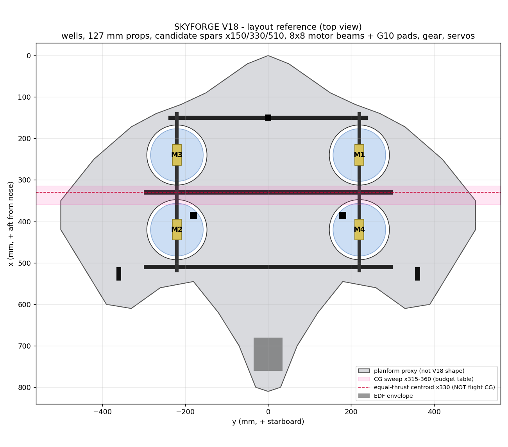

# SKYFORGE V18 FALCON

An educational hybrid-VTOL RC aircraft: falcon / blended-wing styling, four 5-inch lift rotors in wing
wells, one rear 64 mm EDF, elevons + flaps, steerable tricycle gear, fixed FPV camera, one 4S system,
ArduPilot QuadPlane on a SpeedyBee F405 WING.

> **Status: mechanical fitting / development prototype. NOT a proven flying kit and NOT flight-ready.**
> Every named part is a reference candidate until fit and performance are measured. Files are unsliced.
> Nothing here has been flown, bench-tested or slicer-validated.



## What is in this repo

| Path | What | Label |
|---|---|---|
| [`bom/bom.csv`](bom/bom.csv) -> [`docs/BOM.md`](docs/BOM.md) | Improved BOM: supplier links, dimensions, purchase gates, stage tags, change tags | PROTOTYPE-READY |
| [`docs/BUDGET.md`](docs/BUDGET.md) | Running cost + mass + per-motor hover-reserve budget, regenerated by `tools/budget.py` | PROTOTYPE-READY |
| [`docs/WIRING.md`](docs/WIRING.md) | Pin-by-pin wiring for every module, ground scheme, props-off bring-up order | PROTOTYPE-READY (bench) |
| [`config/ardupilot/skyforge_v18_BENCH_ONLY.param`](config/ardupilot/skyforge_v18_BENCH_ONLY.param) | Port map only - not a tune, failsafe set or calibration | PROTOTYPE-READY (bench) |
| [`config/pinmap.csv`](config/pinmap.csv) | FC outputs, timer groups, functions (machine-checked against the .param) | PROTOTYPE-READY |
| [`docs/TEST_GATES.md`](docs/TEST_GATES.md) | Stage 0-2 in detail with PASS/FIX/STOP numbers; stages 3-10 summary | PROTOTYPE-READY |
| [`cad/`](docs/CAD_PARTS.md) | Parametric CadQuery source + STEP / STL / 3MF / DXF for interface parts, layout reference assembly | EXPERIMENTAL |
| [`config/measurements.json`](config/measurements.json) | Where every measured value goes (all `null` today) | - |
| [`BUILD_STATUS.md`](BUILD_STATUS.md) | What is done, open, flagged, unknown | - |

The V18 airframe templates (body, wings, covers, trays, fins, ducts) were not available when this repo was
created; they go in [`cad/v18_baseline/`](cad/v18_baseline/README.md).

## Headline numbers (all PROVISIONAL until measured)

- **Cost:** aircraft USD 908-1,375 (higher than the old USD 728-1,221 because the missing items are now
  itemized); from scratch, excluding the printer, USD 1,375-2,340 including 15-20 % contingency.
- **Mass:** 1,607 g of installed hardware + 778-1,609 g of printed polymer = **2.4-3.2 kg all-up**
  (2.65 kg planning case). The old ~1.5 kg claim is not supported.
- **Hover reserve:** at 2.65 kg and a CG at x345, the rear motors each carry 772 g. To PASS the project
  gate (hover <= 50 % of max), each lift motor must show **>= 1,543 g max static thrust at loaded
  voltage** on the Stage-2 bench, including the beam blockage. Expect that to be hard for a 5-inch 2207
  on 4S; the bench decides, and `docs/BUDGET.md` reports how much mass must come off if it falls short.
- **Current:** transitions put four lift motors and the EDF on one pack at once. The budget computes that
  peak from bench data and gates it against the XT90 class and the pack's C label.

## Quick start

```bash
python3 tools/budget.py          # regenerate docs/BOM.md + docs/BUDGET.md
python3 tools/check_repo.py      # BOM schema, pin map vs .param, timer groups, CAD, gates
pip install -r requirements.txt  # only needed to rebuild CAD
python3 cad/src/build.py         # regenerate STEP/STL/3MF/DXF, layout, checks, renders
```

Workflow: measure -> write the value into `config/measurements.json` (and `owned_items.ids` for parts
you already have) -> `python3 tools/budget.py` -> read the gates in `docs/BUDGET.md` -> buy only the
next stage's rows.

## Engineering-honesty rules this repo follows

- A printed nozzle is not propulsion, a decorative duct is not blade containment, printed skin is not
  the load path. Flight propellers are never printed.
- One 4S system; V18 only. Changes to motors, battery, EDF, span, wing profile, CG or firmware must be
  carried through CAD, BOM, wiring and docs (`tools/check_repo.py` enforces the parts it can).
- Failed and flagged checks are reported, not hidden (see `BUILD_STATUS.md`).
- First flights happen with an experienced RC / QuadPlane pilot at a proper site, line-of-sight.

## Licence

No licence has been chosen yet. Until one is added, all rights are reserved by the author.
