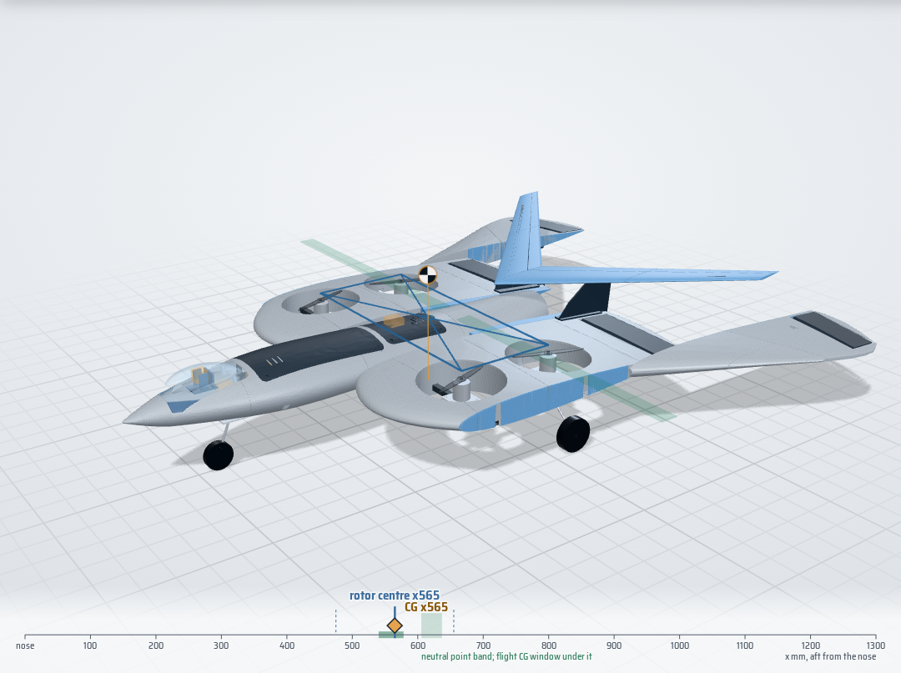
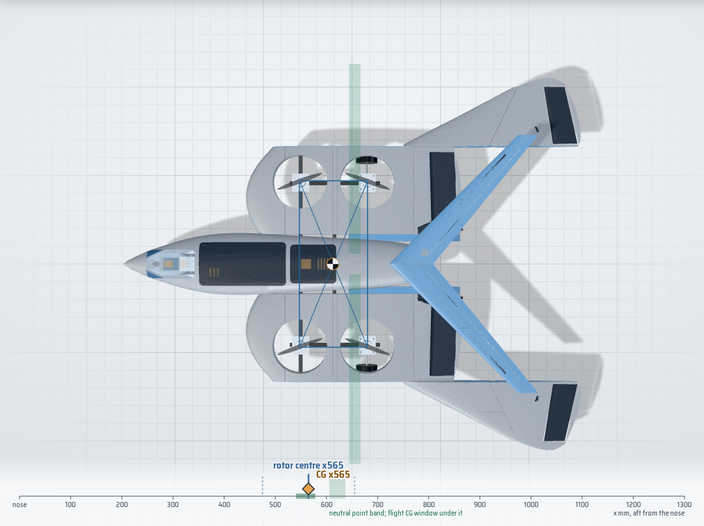

# SKYFORGE Falcon: V18 workbench and V19 variants

An educational hybrid-VTOL RC aircraft with falcon / blended-wing styling: four 5-inch lift rotors, a rear 64 mm
electric ducted fan (EDF), flaps and elevons, a steerable tricycle gear, one 4S system, ArduPilot QuadPlane on a
SpeedyBee F405 WING, printed on a Bambu Lab P1S. This repo is the build workbench around **your V18 design**:
the V18 assembly is the source of truth, every number is computed from it, and the V19 variants are built
from its parts.

**Web version:** https://normansrule.github.io/skyforge-v18-falcon/ · **App version:** Windows / macOS / Linux
installers on the Releases page (same app, works offline). Steps: [docs/PUBLISHING.md](docs/PUBLISHING.md).

> **Status: mechanical fitting / development prototype - not flight-ready.** Nothing here has been flown,
> bench-tested or slicer-validated. Named parts are reference candidates until fitted and measured.



## The headline

**V18 as designed does not balance; V19-F does (in the models), as a drone and as a plane.** V18's CG sits 88 mm
tail-heavy of its rotors and behind its neutral point, and no silhouette-preserving tweak fixes both. Each V19 direction
was built from the V18 parts, collision-checked and evaluated with the masses of the parts as modelled
([docs/V19_VARIANTS.md](docs/V19_VARIANTS.md)):

| | Mass | CG x | CG from the centre of the 4 motors | Static margin | Heaviest motor | Result |
|---|---:|---:|---:|---:|---:|---|
| V18 as designed | 2,724 g | 418 | 88 mm aft | -24.6 % | 49.6 % | STOP |
| V19-A long-nose falcon (wing 200 mm aft, nose-bay battery) | 2,728 g | 449 | 2 mm | -6.0 % | 25.6 % | STOP |
| V19-B falcon tail (0.15 m², wing 120 mm aft) | 2,912 g | 483 | 0.5 mm | -3.3 % | 25.2 % | STOP |
| V19-C forward rotors on booms (wing 275 mm aft) | 2,883 g | 480 | 0 mm | 7.4 % | 25.0 % | **PASS** |
| V19-R forward rotors on booms + 0.05 m² tail (wing 250 mm aft) | 3,006 g | 499 | 10 mm | 7.1 % | 26.5 % | **PASS** |
| V19-W four rotors in your wing wells + 0.18 m² boom tail (wing 200 mm aft) | 3,014 g | 533 | 3 mm | 8.2 % | 26.0 % | **PASS** |
| V19-S stoop 300 mm + 0.07 m² crest (wing 225 mm aft) | 2,825 g | 556 | 1.0 mm | 7.2 % | 25.3 % | **PASS** |
| V19-G stoop 300 mm + slim 0.06 m² crest (wing 235 mm aft) | 2,827 g | 564 | 0.7 mm | 6.8 % | 25.2 % | **PASS** |
| **V19-F recommended**: stoop 340 mm + slim 0.055 m² crest (wing 235 mm aft) | 2,829 g | 565 | 0.2 mm | 7.5 % | 25.1 % | **PASS** |

Gates: static margin 5-25 % of the mean chord, heaviest motor no more than 30 % of the weight in hover, pitch trim
within 10° at 16 m/s, no new collisions.

**Hover first.** For the drone half of the flight the CG has to sit where the diagonals between the four lift motors
cross, so each motor lifts a quarter of the weight. V19-S, G and F are three looks on one layout that does that: all
four rotors in your V18 wing wells, and the battery slides a few millimetres in your V18 tray to put the CG on the
crossing point (V19-F: 0.2 mm off, every motor 24.9-25.1 %). The web app draws the motor rectangle and its diagonals over
the model, so you can see the CG marker sit on the crossing.

**V19-F** then gets its flight stability without the big tail:

- **Deep stoop.** The outer falcon panels and elevons sweep 340 mm back at the wrist (your V18 seam at y 315), like a
  falcon tucking its wings in a dive. A swept carbon spar in each wrist (254 mm, 60°) carries them.
- **Slim falcon crest.** A 0.055 m² crest (45° sweep, aspect ratio 8) sits on the tips of your own V18 fins, right over
  the EDF. It is set 6° leading edge down and has a small elevator on one slim servo.

The battery stays in the V18 tray (no nose bay); the aircraft is 186 g lighter and 128 mm shorter than V19-W. The
rear motors and main gear ride on short carbon booms under the wing. The FPV camera sits at a pilot's eye point under a
clear canopy; try the **Pilot** view in the app. The single V18 64 mm EDF stays in the jet bay as the cruise engine.
Print set, STLs, cut list and buy list: [`cad/v19/v19f_swift_stoop/`](cad/v19/v19f_swift_stoop/) and the V19 document.
V19-S (shorter stoop, bigger crest) has the same file set; V19-G is a concept look.



## Quick start (Ubuntu / WSL2)

```bash
mkdir -p ~/src && cd ~/src && git clone git@github-normansrule:Normansrule/skyforge-v18-falcon.git
cd skyforge-v18-falcon
./scripts/setup_ubuntu.sh        # once: apt packages, .venv, Node packages (add --desktop for the app)
make serve                       # web app at http://localhost:8080
make help                        # everything else: check, budget, v18, v19, web, desktop, publish
```

Workflow: measure something, enter it in the web app's **Budget** or **Bench** tab (or `config/measurements.json`),
`make budget`, and buy only the next stage's rows. The **V19** tab switches the 3D model between V18 and the
variants (with an X-ray ghost of V18 for comparison) and lists every part that changes.

## What is here

| Path | What | Label |
|---|---|---|
| [`site/`](site/) | Web app: 3D model with picking, layers, explode, cut-away, control sweep, balance ruler, hover frame, V18/V19 switcher, pilot's-eye view; balance explorer; live budget; bench log ingest; wiring map; stage tracker; all docs. Offline-capable | PROTOTYPE-READY |
| [`desktop/`](desktop/) | Tauri v2 desktop shell around `site/` | PROTOTYPE-READY |
| [`cad/v18/`](cad/v18/) | Your V18 assembly, extracted part data, G10 cutting DXFs, carbon cut list, your original V18 BOM | source |
| [`cad/v19/`](cad/v19/), [`config/v19/`](config/v19/) | V19 variants: configurations, new and modified parts (STL, 3MF print sets for C, R, W, S and F, DXF), collision and fit checks, mass inputs | EXPERIMENTAL |
| [`cad/interface/`](cad/interface/) | Parametric parts for the joints V18 left open: crossing clamps, belly straps, EDF ear brackets, FC isolation pad, nose-steering collar | EXPERIMENTAL |
| [`bom/bom.csv`](bom/bom.csv) -> [`docs/BOM.md`](docs/BOM.md) | V18 BOM rows plus added rows, with links, stages, purchase gates and V18 placements | PROTOTYPE-READY |
| [`docs/V19_VARIANTS.md`](docs/V19_VARIANTS.md) | The V19 directions and V19-F: hover balance, numbers, changes, parts, checks, engine choice, V19-F build changes | results |
| [`docs/BALANCE_AND_STABILITY.md`](docs/BALANCE_AND_STABILITY.md) | Why V18 does not balance | results |
| [`docs/BUDGET.md`](docs/BUDGET.md) | Running cost, mass, CG, hover and stability gates | generated |
| [`docs/WIRING.md`](docs/WIRING.md), [`docs/HARNESS.md`](docs/HARNESS.md) | Pin-by-pin wiring per module; harness cut list | PROTOTYPE-READY (bench) |
| [`docs/V18_CHECKS.md`](docs/V18_CHECKS.md) | Prop/well clearance, seams, control sweeps, gear, P1S fit | results |
| [`docs/TEST_GATES.md`](docs/TEST_GATES.md) | Stage 0-10 with PASS/FIX/STOP numbers | PROTOTYPE-READY |
| [`firmware/thrust_stand/`](firmware/thrust_stand/) | Arduino Nano + HX711 thrust-stand logger | PROTOTYPE-READY (compiles) |
| [`config/ardupilot/`](config/ardupilot/) | Bench-only ArduPilot port map | PROTOTYPE-READY (bench) |
| [`tools/`](tools/), [`tools/v19/`](tools/v19/) | Extraction, mass/CG, vortex lattice, geometry checks, balance study, V19 search/geometry/report, budget, harness, bench ingest, web export, repo checks | - |
| [`scripts/`](scripts/), [`Makefile`](Makefile) | One-command setup and publishing | - |

## Engineering rules this repo keeps

- V18 is the baseline and one 4S system throughout. Your V18 parts win over any candidate; V19 changes them only
  where a variant has to, and every change is listed.
- A printed nozzle is not propulsion, a decorative duct is not blade containment and printed skin is not the
  load path (V19 loads go through carbon booms and crossrails). Never print flight propellers.
- Failed and flagged checks are reported, not hidden (`make check` lists them).
- First flights happen with an experienced RC / QuadPlane pilot at a proper site, line-of-sight.

## Licence

No licence has been chosen yet; until one is added, all rights are reserved by the author. The vendored
libraries in `site/vendor/` keep their own licences (three.js MIT, marked MIT, fonts SIL OFL).
