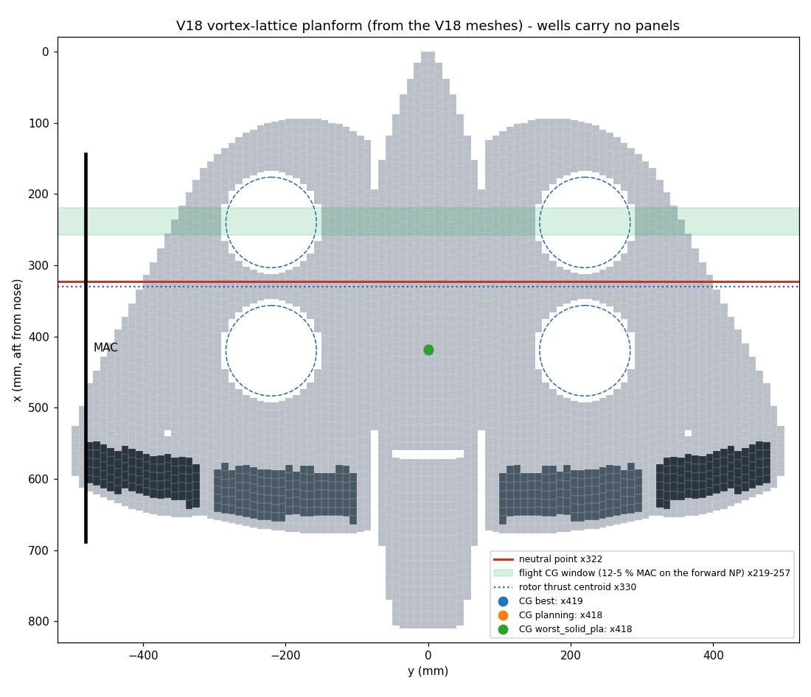
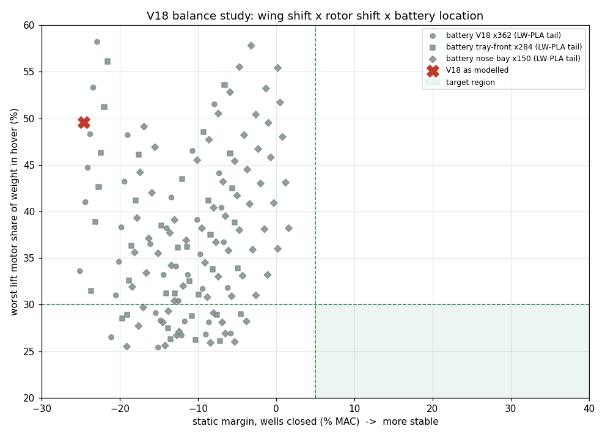

# Balance and stability: the finding that gates V18

> **Update (V19):** the configuration decision this document asks for has been worked through in
> [V19_VARIANTS.md](V19_VARIANTS.md). V19-F (four rotors in the wing wells with the CG on their centre, wing 235 mm aft, deep stoop wing and a slim falcon crest on the V18 fins, no boom tail) passes
> every model gate with the masses of the parts as modelled.

**Status: STOP for bulk buying and printing.** The V18 assembly as modelled cannot hover
balanced *and* fly stable on its wing. This is the most important result in the repo, and it is
a configuration decision for the designer, not something a part swap fixes.

All numbers come from your V18 file (`cad/v18/V18_EQUIPMENT_ASSEMBLY_VIEW_ONLY.3mf`) and the BOM
(`bom/bom.csv`). They are model values until Stage 9 weighs the real aircraft.



## 1. Where the centre of gravity (CG) is

`tools/mass_cg.py` places every mass where V18 puts it:
- Printed parts: mesh volume × material density, at the mesh centroid.
- Carbon: length × mass per metre.
- G10: volume × 1.85 g/cm³.
- Purchased parts: BOM mass at the V18 keep-out box, motor envelope, prop or gear mesh.

| LW-PLA density | All-up mass | CG x (mm from nose) | Front motors (each) | Rear motors (each) |
|---|---|---|---|---|
| 0.60 (best case) | 2,515 g | 418.7 | ~9 g | ~1,249 g |
| 0.80 (planning) | 2,724 g | 418.4 | ~12 g | ~1,350 g |
| 1.24 (solid PLA) | 3,183 g | 417.8 | ~20 g | ~1,572 g |

(Includes the ~30 g of repo interface parts at their V18 sites.)

- The rotor thrust centroid is x330, so the CG is **88 mm aft of it**. In hover the rear pair would carry
  about 49.6 % of the weight each and the front pair almost nothing.
- Density barely moves the CG. The hardware alone has its CG near x400, and the printed skin (42 % of the
  mass) has its CG at x441. Both are aft.
- The largest aft contributors are the EDF + saddles + ducts + F4 tail cone (~300 g between x620 and x780),
  the aft inner wing panels C/D with the flaps, the outer falcon panels, and the elevons and servo
  cassettes.

## 2. Where it needs to be: the neutral point (NP)

`tools/aero_vlm.py` slices the V18 lifting parts (body F1–F4, wing panels A–F, flaps, elevons) into
spanwise sections. It then runs a vortex-lattice method (VLM) with the camber line, the rotor wells as
holes, and the flaps and elevons tagged.

**Validation.** On two textbook wings it agrees with AeroSandbox's independent VLM to within 0.3 %:

| Wing | Lift slope | Aerodynamic centre |
|---|---|---|
| Rectangular, AR 6 | 4.271 vs 4.274 /rad | 0.239 vs 0.239 c |
| 45°-swept, AR 5 | 3.249 vs 3.239 /rad | 1.436 vs 1.433 c |

On the V18 planform with the wells filled, both codes give an NP within 1 mm of each other (x284.6 vs
x283.8).

| V18 planform | Value |
|---|---|
| Wing area (wells removed / gross) | 0.416 / 0.481 m² |
| Span, aspect ratio | 1.000 m, 2.40 |
| Mean aerodynamic chord (MAC) | 544 mm, leading edge at x144 |
| Lift slope | 2.58 /rad |
| NP band (wells closed to open, body lifting or not) | **x285 to x332** (the balance study uses the body-lifting bounds x285 and x325 for its own geometry variants) |
| CG window for 5–12 % static margin (forward NP) | x219 to x257 |

The real NP lies inside the band. Stopped props in open wells behave somewhere between a hole and a
closed surface.

**Static margin at the modelled CG: −24.6 % to −15.8 % of MAC.** Negative means unstable. Even with the
CG moved into the right place, the outer elevons alone would need −13° to −18° of up-trim at 15 m/s.
All four trailing-edge surfaces used together would need −5° to −6.5° (`docs/WIRING.md` section 14).

## 3. Why no single fix works

The rotor centroid (x330) sits on or aft of the NP band (x285–332). For hover the CG must sit on the
rotor centroid. For flight it must sit 5 % or more of the MAC (≥27 mm) ahead of the NP. With the rotors
embedded symmetrically in the inner chord, those two requirements contradict each other.

`tools/balance_study.py` searched 576 combinations of design changes that keep the falcon silhouette:
- Wing group (wings, controls, fins, servo cassettes and rotors together) moved 0–210 mm aft relative
  to the nose.
- Rotors moved −40 to +60 mm within the wing. Forward needs a leading-edge extension: the existing
  leading edge leaves only 3.5 mm of room.
- Battery at V18 x362, at the front of Tray A (x284), or in a new nose bay (x150).
- FC, VTX and EDF ESC moved into the vacated battery bay.
- Tail ducts and EDF saddles in LW-PLA.
- LW-PLA at 0.80 or 0.60.



**No combination passes both gates** (hover: heaviest motor ≤ 30 % of weight; flight: margin ≥ 5 % on
the forward NP, trim ≤ 10°). The closest:
- **Wing group +210 mm aft, rotors −40 mm, nose-bay battery, avionics forward, LW-PLA tail, 0.60
  density.** Margin is +3.8 % (closed) to +12.9 % (open), but the CG is 59 mm off the rotors (heaviest
  motor 41.5 %).
- **Wing group +150 mm aft, rotors −40 mm, nose-bay battery, LW-PLA tail, 0.60 density.** Hover balances
  (heaviest motor 28.6 %) but the margin is −3.5 % (closed) to +5.6 % (open); at 0.80 density the same layout gives
  26.0 % and −5.3 % to +3.8 %. It works only if the open wells
  behave like holes.

Nose ballast is not a fix either: about 750 g at the nose only puts the CG on the rotors (static margin still about −8 %), and reaching a 5 % margin would take about 1.7 kg.

## 4. Directions for V19 (the designer's call)

These are the routes that can close the gap. Each one changes the configuration, so each needs the
CAD revised and this study re-run:

1. **Long-nose falcon.** Move the wing group 150–200 mm aft relative to the nose and cockpit, so the
   head sits well ahead of the wing like a falcon's. Move the rotors about 40 mm forward inside a
   broadened inner-wing leading edge (the "shoulders"), put the battery in a nose bay, and print the tail
   parts in LW-PLA. This is the nearest region in the study and keeps the styling. It still needs the
   wells to act open, or a little more NP shift.
2. **Falcon tail.** Add a horizontal tail (a bird-like fan between or behind the fins). This moves the
   NP aft independently of the rotors. A useful shift (~70 mm) needs a tail around 15–20 % of the wing
   area on a ~0.5 m arm, which is a large visual change.
3. **Rotors out of the chord.** Put the front rotor pair forward of the wing leading edge (booms or a
   canard-like nose pod) so the rotor centroid sits ahead of the NP. This breaks the "rotors in wells"
   look but is how most QuadPlanes solve it.
4. **Unequal rotors.** Keep the layout but carry the CG ahead of the rotor centroid by giving the front
   pair more thrust (larger wells and props). This is limited by the 145 mm wells and adds a second
   motor/prop type.

## Re-running

```bash
python3 tools/mass_cg.py && python3 tools/aero_vlm.py && python3 tools/balance_study.py
```

The balance study takes about 6 minutes. The web app's Balance tab shows every precomputed
combination and moves the 3D model to match.
