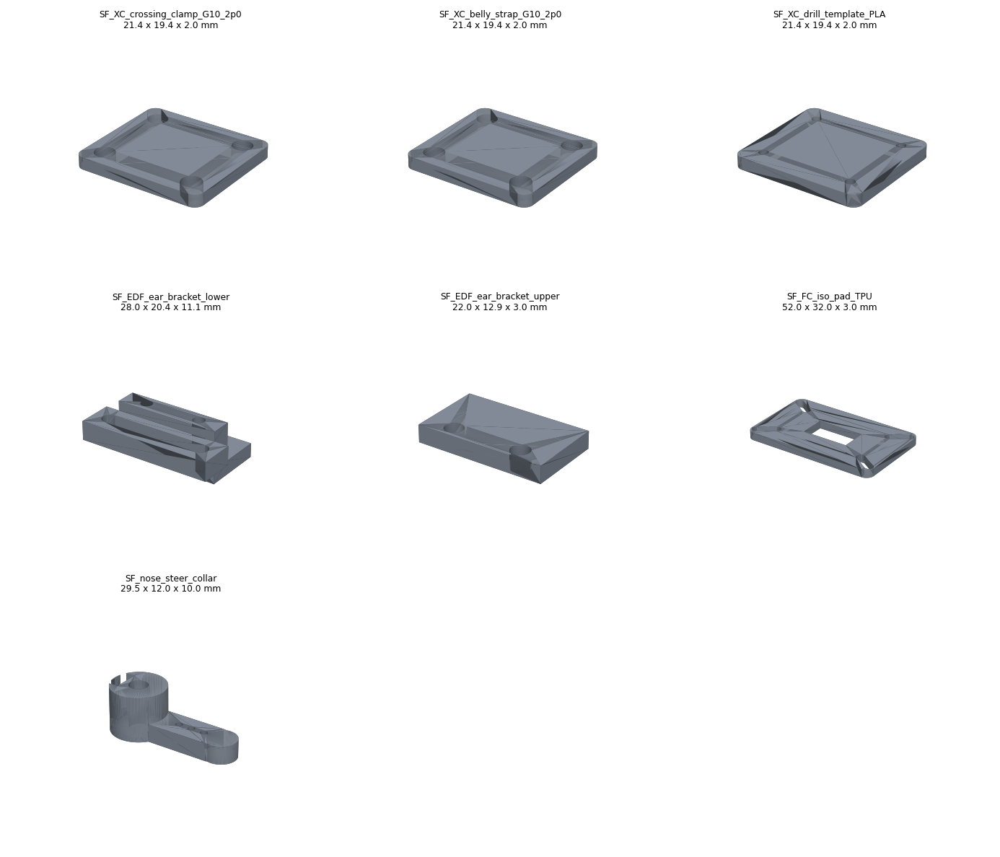

# CAD in this repo

## Your V18 geometry (`cad/v18/`)

| File | What |
|---|---|
| `V18_EQUIPMENT_ASSEMBLY_VIEW_ONLY.3mf` | Your V18 assembly, the source of truth for every analysis here. View only: print from your V18 P1S print files |
| `parts.json` | Every object: class, template, side, volume, centroid, bounding box, oriented size, best P1S placement |
| `dxf/*.dxf` | 1:1 cutting profiles of the 15 flat G10 plates, extracted from V18 with the modelled holes (motor plates, backers, gear plates, nose bridge, cassette strips) |
| `carbon_cut_list.json` | Every carbon tube packed onto 1 m stock with a 2 mm kerf |
| `V18_BOM_AND_BUDGET_original.md` | Your V18 BOM, kept for reference. `bom/bom.csv` carries its rows forward |

`python3 tools/v18_extract.py --stl` writes per-part STLs in the assembled pose to `cad/v18/stl/`
(git-ignored, about 90 MB).

## Interface parts (`cad/interface/`)

These fill the V18 joints the brief listed as undefined. They are parametric (CadQuery):
`cad/interface/src/params.py` holds every dimension and `build.py` builds, exports and fit-checks them.

```bash
pip install -r requirements.txt
python3 cad/interface/src/build.py
```

Outputs go in `cad/interface/out/`: `step/`, `stl/`, `3mf/` (printed parts, unsliced), `dxf/` (G10
profiles), `png/parts_sheet.png`, `manifest.json` and `fit_check.json`.



| Part | Qty | Material | Label | V18 fit | Notes |
|---|---|---|---|---|---|
| `SF_XC_crossing_clamp_G10_2p0` | 10 | G10 2.0 mm | EXPERIMENTAL | PASS | Plate above and below each crossrail/keel crossing (4 crossings), plate above each keel/gear-crossbar crossing (2). M3 × 25, nylock |
| `SF_XC_belly_strap_G10_2p0` | 2 | G10 2.0 mm | EXPERIMENTAL | PASS | The same plate fitted outside the belly under each gear crossing, through the skin cut-out the crossbar already needs. M3 × 35 |
| `SF_XC_drill_template_PLA` | 1 | PLA | PROTOTYPE-READY | - | Tool for scribing and centre-punching the G10 |
| `SF_EDF_ear_bracket_lower` / `_upper` | 2 + 2 | PA-CF (PETG for fit tests) | EXPERIMENTAL | PASS | C-bracket on each 8 × 8 EDF outrigger at x695 with a slotted ear tab. It wraps only the inboard, top and bottom faces because V18 leaves 1.4 mm between the outrigger and the F4 skin. Drill to the measured E7206 ear |
| `SF_FC_iso_pad_TPU` | 1 | TPU 95A | EXPERIMENTAL | PASS | 52 × 32 × 3 pad inside the V18 FC keep-out. Slotted because the FC hole pattern is unconfirmed |
| `SF_nose_steer_collar` | 1 | PETG | EXPERIMENTAL | not placed | For a 4 mm nose leg: M3 set screw, clevis holes at 10/13/16 mm |

Labels: **FINISHED** means verified on real parts (nothing yet); **PROTOTYPE-READY** means ready for its
stage's fit or bench test; **EXPERIMENTAL** means a design proposal that is not yet verified.

## Print notes (P1S)

- All V18 parts fit the 256 mm bed. `WRE1`/`WLE1` must be placed rotated about 29° (see `parts.json`).
- Interface parts in PETG/PA-CF: 5 walls, 40 % gyroid, 0.2 mm layers. Print the EDF lower bracket
  tab-down.
- TPU pad: 0.2 mm layers, 3 walls, 20 % infill, ≤ 30 mm/s.
- None of these files has been sliced or test-printed; no Bambu project or G-code is validated.

## V19 parts

The V19 variants' new and modified parts (booms, pods, risers, hangers, well caps, root fairings, tail booms,
fins, stabiliser, elevators, nose-bay floor and rails, and the V18 panels with new slots) are generated by
`tools/v19/geometry.py` into `cad/v19/<variant>/`. Full file sets (STL, 3MF print set, DXF) exist for the
passing variants V19-C and V19-R; see [V19_VARIANTS.md](V19_VARIANTS.md) for the lists, masses and checks.
