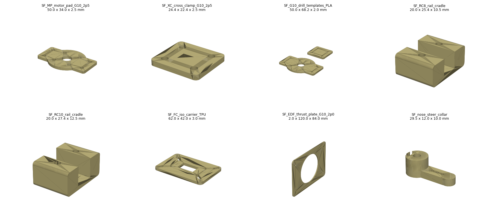

# CAD parts in this repo

Source: `cad/src/params.py` (all dimensions) + `cad/src/build.py` (geometry, exports, checks).
Regenerate everything with `python3 cad/src/build.py` (needs `pip install -r requirements.txt`).

These parts **fill the V18 interface gaps** listed in the brief (carbon clamps / compression pads,
motor mounting load path, EDF thrust bracket, nose-steering attachment, FC isolation). They do **not**
replace or reproduce the V18 airframe templates (F1-F4, wings, covers, trays, fins, ducts), which were not
attached to this conversation. Put the V18 archives in `cad/v18_baseline/` (see its README).

Files are unsliced; no Bambu project or G-code has been validated.

| Part | Qty / aircraft | Material | Label | Made how | Notes |
|---|---|---|---|---|---|
| `SF_MP_motor_pad_G10_2p5` | 4 | G10 2.5 mm | EXPERIMENTAL | Cut from DXF | Motor 16x16 M3 pattern, 9 mm shaft relief, four M3 clamp holes straddling the 8x8 beam |
| `SF_XC_cross_clamp_G10_2p5` | 16 | G10 2.5 mm | EXPERIMENTAL | Cut from DXF | Two plates per beam/spar crossing, M3 x 25 through the 18 mm stack |
| `SF_G10_drill_templates_PLA` | 1 | PLA | PROTOTYPE-READY | Print flat | Scribe/centre-punch template for the two G10 parts - a tool, not a flight part |
| `SF_RC8_rail_cradle` | 8 | PETG or PA-CF | EXPERIMENTAL | Print floor-up | Under the 8x8 motor beam; channel 0.5 mm shallow for clamp preload; 0.8 mm compression-pad recess; M3 nut traps |
| `SF_RC10_rail_cradle` | per V18 rails | PETG or PA-CF | EXPERIMENTAL | Print floor-up | Same for 10x10 spars (gear plate, EDF rails) |
| `SF_FC_iso_carrier_TPU` | 1 | TPU 95A | EXPERIMENTAL | Print flat | Slotted because the FC hole pattern is not confirmed from a reliable source - measure, then narrow the slots |
| `SF_EDF_thrust_plate_G10_2p0` | 1 | G10 2.0 mm | EXPERIMENTAL | Cut from DXF | 65 mm clear fan opening; ear ring left undrilled - drill to the measured EDF |
| `SF_nose_steer_collar` | 1 | PETG | EXPERIMENTAL | Print on end | Test piece for a 4.0 mm leg wire (MEASURE); M3 set screw + nut trap; clevis holes at 10/13/16 mm |
| `SF_LAYOUT_V18_reference` (STEP + GLB) | - | - | reference | - | Planform **proxy** (not the V18 shape) with wells, 127 mm prop discs, candidate spars x150/330/510, motor beams, pads, EDF envelope, servos, gear |

## Why a beam + pad instead of a flat G10 bridge

The first candidate was a single 2.5 mm G10 bridge spanning the well spar-to-spar (180 mm). Treated as a
simply supported plate loaded at mid-span by 1.2 kg of thrust, it deflects about 3.8 mm flatwise
(E ~ 18 GPa, I = 21 mm^4). An 8 x 8 x 1 pultruded carbon tube over the same span deflects about 0.1 mm,
and the G10 is then only a 50 mm pad. This keeps the brief's load path (motor -> G10 -> carbon) and uses the
8 x 8 tube already in the BOM. These are hand estimates; the Stage-3 hang test is the real check.

## Computed layout checks (`cad/out/checks/layout_checks.json`)

| ID | Result | Meaning |
|---|---|---|
| L1 | PASS | 9 mm radial prop margin in the 145 mm well |
| L2 | PASS | 35 mm web between wells fits a 10 mm spar |
| L4 | PASS | Outer servos ~104 mm from the nearest well edge |
| **L5** | **FLAG** | Main wheels at (385, +/-180) sit inside the rear-rotor well footprints in plan view. The leg must attach inboard of \|y\| = 147.5, stay below the rotor wash, and be present in the thrust measurement |
| **L6-360** | **FLAG** | If the flight CG lands near x360, the x385 main axle leaves only 25 mm tip-back margin |
| **L7** | **FLAG** | Beam + pad block ~10 % of the prop disc outside the motor footprint - bench the prop with them in place (Stage 2) |
| L3, L8 | PASS (proxy) | Only meaningful against the real V18 outline |

## Print notes (P1S)

- All printed parts fit the 256 mm bed; largest is 68 mm.
- PETG/PA cradles: 5 walls, 40 % gyroid, 0.2 mm layers, print floor-up so the nut traps are bridged.
- TPU carrier: 0.2 mm, 3 walls, 20 % infill, slow (<= 30 mm/s).
- Colour: cradles and pads are hidden structure - print them in any colour; keep charcoal for visible
  covers per the V18 scheme.
