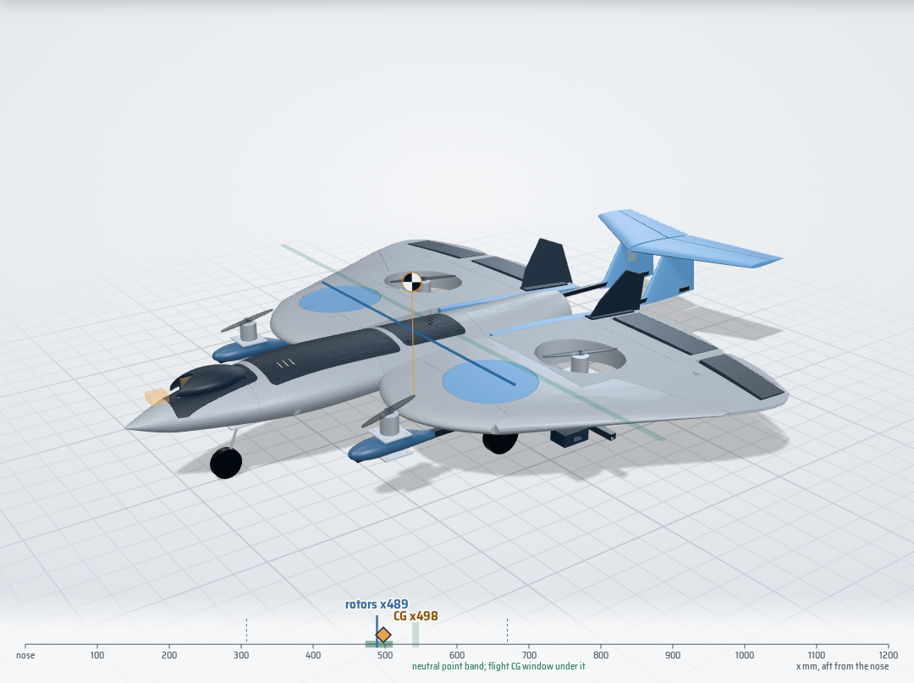
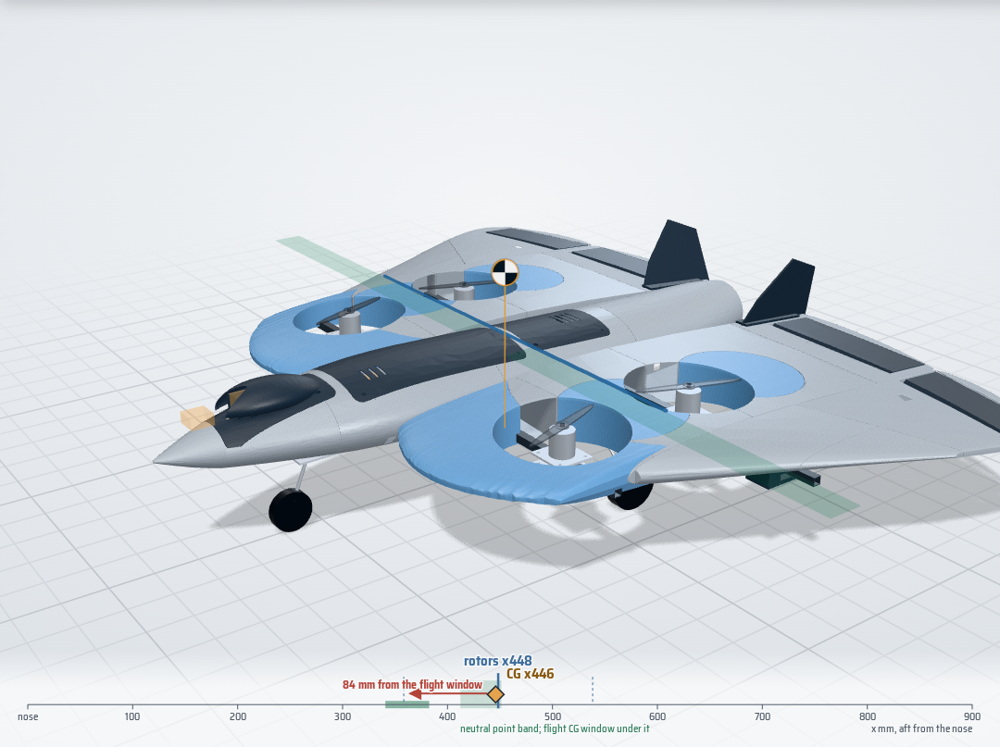
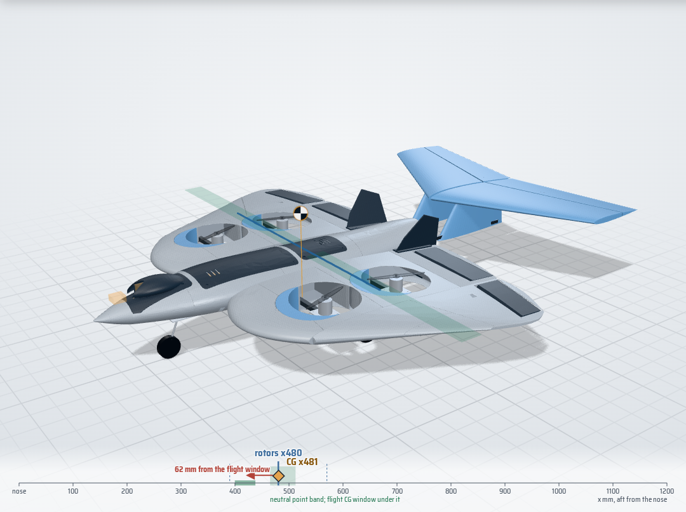
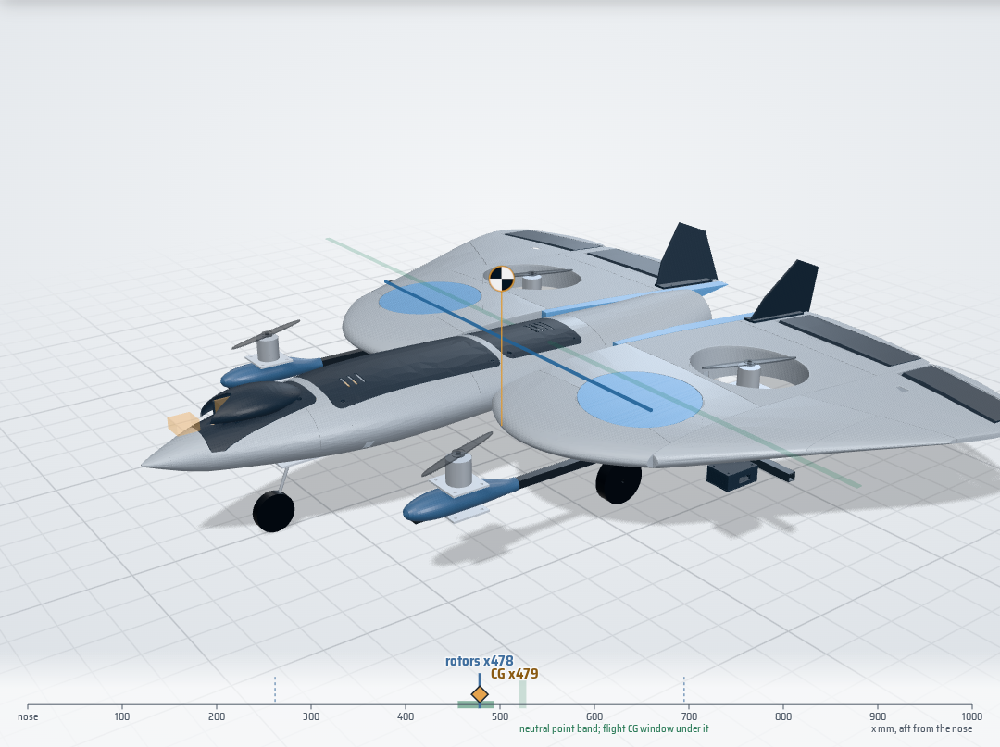

# V19 variants: long nose, falcon tail, forward rotors

> Screening results from the point-mass + vortex-lattice models, with the masses of the parts as the V19 geometry models them. Nothing has been built yet. Not a flight clearance: bench and fit gates in [TEST_GATES.md](TEST_GATES.md) still decide.

Your three directions, each built from your V18 assembly (`tools/v19/geometry.py`), collision-checked against V18 and evaluated with the same gates as V18: heaviest motor in hover no more than 30 % of the weight, static margin 5-25 % of the mean chord, pitch trim within 10 deg at 16 m/s, prop and flap clearances.

## The answer

|  | Mass g | CG x | Rotors x | Static margin % (wells closed / open) | Heaviest motor % | Trim 16 m/s deg | Length mm | New collisions | Gates |
|---|---:|---:|---:|---:|---:|---:|---:|---:|---:|
| V18 as designed | 2724 | 418 | 330 | -24.6 / -17.1 | 49.6 | 53.5 / 45.0 | 810 | - | STOP |
| V19-A | 2719 | 446 | 448 | -5.6 / 0.9 | 25.7 | 15.8 / 6.1 | 877 | 0 | STOP |
| V19-B | 2913 | 481 | 480 | -2.9 / 5.8 | 25.2 | -0.2 / -3.4 | 1188 | 1 | STOP |
| V19-C | 2883 | 479 | 478 | 7.7 / 9.1 | 25.0 | -6.6 / -9.0 | 952 | 0 | **PASS** |
| V19-R | 3006 | 498 | 489 | 7.4 / 9.1 | 26.3 | -4.6 / -5.9 | 1175 | 0 | **PASS** |

**Build V19-R.** It is your long-nose falcon with the other two directions folded in: the wing group 250 mm aft of the nose, the front rotor pair on booms ahead of the leading edge, and a 0.05 m2 falcon tail. With the parts as modelled it weighs 3006 g, its CG sits 9 mm from the rotor centroid, the heaviest motor carries 26.3 % in hover, and the static margin is 7.4 % to 9.1 %. The rear rotors stay in your V18 wells. V19-C (no tail, wing 275 mm aft) also passes and is the fallback if the tail disappoints on the bench.

### Why each direction alone is not enough

- **Long nose alone (V19-A).** Moving the wing aft moves the neutral point aft almost one for one, but the CG only by the wing group's share of the mass. That helps, and the nose-bay battery helps more, yet at 200 mm the static margin is still -5.6 % and trim needs 16 deg of surface: the rotors have to follow the CG forward inside the wing, which needs a leading-edge glove, and the front wells then eat the lift ahead of the CG. Search rows: 150-200 mm, 0.6-0.8 g/cm3; none passes.
- **Falcon tail alone (V19-B).** A horizontal tail moves the neutral point aft without moving much mass, but on V18's short body it has a short arm. Even 0.15 m2 at a 120 mm wing shift leaves -2.9 %, and with the rotors balanced in the wing the rear crossrail lands in the D1 intake.
- **Forward rotors (V19-C).** Taking the front pair out of the wing lets the rotors balance the CG without the wing having to move under them, and closing the front wells gives back lift ahead of the CG. With the long nose it passes on its own at 275 mm.
- **Together (V19-R).** With a tail a third the size of V19-B's, the wing needs to move 250 mm instead of 275 mm and the rear rotors stay in your V18 wells; static margin 7.4 %.

Why 250 mm and not 150-200 mm: with the modelled booms, pods, risers, tail booms and fins (about 359 g of new parts, most of it aft of the CG) the 200 mm combinations miss either the 5 % margin or the 30 % motor limit. 225 mm with the 0.05 m2 tail passes by a hair (5.2 %); 250 mm gives margin to spare. The search table is in `analysis/v19_search.json`.

## V19-A long-nose falcon

_Wing group 200 mm aft, battery in a nose bay, rotors stay in the wing wells._ **Fails: static margin -5.6 % with the wells closed (needs 5 % or more): the CG is 34 mm behind the neutral point; pitch trim needs 16 deg of surface at 16 m/s.**

What changes:

- Wing group 200 mm further aft of the nose: inner and falcon panels, flaps, elevons, fins and servo cassettes move together; nose, body, trays and EDF stay.
- Battery to a nose bay (pack centre x 157): 1.5 mm G10 floor on the keel tops, PETG rails; pack no larger than 136 x 44 x 31 mm; camera-cradle base trimmed 7 mm; lift C1 to reach the pack.
- Tray A slides 16 mm aft; FC with the VTX stacked on it, and the EDF ESC, move into its old battery pocket. Tray B stays as the receiver / spare bay.
- Both rotor pairs move -82 mm within the wing (crossrails with them): wells re-cut, the uncovered parts of the V18 wells filled.
- Leading-edge glove takes the inner-wing leading edge 85 mm forward (y 82-314) so the front wells keep 35 mm of wing ahead of them.
- Main gear to x 493 (CG + 45 mm) and 1.5 mm lower.

| Mass | CG | Rotors front / rear | Neutral point closed / open | Hover g M1/M2/M3/M4 | 16 m/s alpha / surfaces deg | 20 m/s alpha / surfaces deg | Stall m/s (CLmax 0.9) |
|---|---:|---:|---:|---:|---:|---:|---:|
| 2719 g | x 445.9 | x 358.3 / 538.3 | x 412.3 / 451.4 | 698 / 661 / 698 / 662 | 7.8 / 15.8 | 5.2 / 12.7 | 9.6 |

New parts (174 g), STL in `cad/v19/v19a_long_nose/stl/`:

| Part | Material | g | Mass basis | P1S |
|---|---:|---:|---:|---:|
| `NEW_G10_nose_battery_floor` | G10 | 18.6 | volume x density | - |
| `NEW_leading_edge_glove_L` | LW-PLA | 47.4 | V18 skin areal density x planform | fits |
| `NEW_leading_edge_glove_R` | LW-PLA | 47.4 | V18 skin areal density x planform | fits |
| `NEW_nose_battery_rails` | PETG | 7.8 | volume x density | fits |
| `NEW_well_fill_L` | LW-PLA | 26.3 | V18 skin areal density x planform | fits |
| `NEW_well_fill_R` | LW-PLA | 26.3 | V18 skin areal density x planform | fits |

Your V18 parts that change (concept variant: the cut panels are shown in the web viewer; files are exported only for V19-C and V19-R):

- `CAM_19mm_cradle`: base trimmed 7 mm for the nose-bay pack; camera stays put
- `WRA_hollow_wing`: re-cut rotor wells; slot for the crossrail at its new station; nose trimmed under the leading-edge glove
- `WRB_hollow_wing`: re-cut rotor wells; slot for the crossrail at its new station; nose trimmed under the leading-edge glove
- `WRC_hollow_wing`: re-cut rotor wells; slot for the crossrail at its new station
- `WLA_hollow_wing`: re-cut rotor wells; slot for the crossrail at its new station; nose trimmed under the leading-edge glove
- `WLB_hollow_wing`: re-cut rotor wells; slot for the crossrail at its new station; nose trimmed under the leading-edge glove
- `WLC_hollow_wing`: re-cut rotor wells; slot for the crossrail at its new station
- `WRE1_falcon_wing`: slot for the crossrail at its new station
- `WLE1_falcon_wing`: slot for the crossrail at its new station
- `WRE2_falcon_wing`: slot for the crossrail at its new station
- `WLE2_falcon_wing`: slot for the crossrail at its new station
- `F2_hollow_body`: slot for CF_crossrail_270_10x10x620 at x 358.3
- `F3_hollow_body`: slot for CF_crossrail_450_10x10x820 at x 538.3; slot for CF_gear_crossbar_10x10x340 at x 493.1

Checks: 0 new collisions against V18; 13 intended contacts (clamps, sockets, bonded joints, listed in `cad/v19/v19a_long_nose/checks.json`).

## V19-B falcon tail

_Horizontal tail on twin swept fins at the ends of the EDF outrigger booms; wing 120 mm aft._ **Fails: static margin -2.9 % with the wells closed (needs 5 % or more): the CG is 16 mm behind the neutral point; the rear crossrail runs into the D1 belly intake.**

What changes:

- Wing group 120 mm further aft of the nose: inner and falcon panels, flaps, elevons, fins and servo cassettes move together; nose, body, trays and EDF stay.
- Battery to a nose bay (pack centre x 157): 1.5 mm G10 floor on the keel tops, PETG rails; pack no larger than 136 x 44 x 31 mm; camera-cradle base trimmed 7 mm; lift C1 to reach the pack.
- Tray A slides 16 mm aft; FC with the VTX stacked on it, and the EDF ESC, move into its old battery pocket. Tray B stays as the receiver / spare bay.
- Both rotor pairs move +30 mm within the wing (crossrails with them): wells re-cut, the uncovered parts of the V18 wells filled.
- Falcon tail: 0.150 m2 stabiliser, 693 mm span, 28 deg sweep, 80 mm above the wing plane on two swept fins; 35 % elevator, one servo in the starboard fin. The V18 EDF outriggers become one-piece 8 x 8 tail booms.
- Main gear to x 525 (CG + 45 mm) and 1.5 mm lower.

| Mass | CG | Rotors front / rear | Neutral point closed / open | Hover g M1/M2/M3/M4 | 16 m/s alpha / surfaces deg | 20 m/s alpha / surfaces deg | Stall m/s (CLmax 0.9) |
|---|---:|---:|---:|---:|---:|---:|---:|
| 2913 g | x 480.7 | x 390.2 / 570.2 | x 464.9 / 512.1 | 726 / 731 / 724 / 733 | 8.7 / -0.2 | 6.1 / -0.5 | 10.4 |

New parts (321 g), STL in `cad/v19/v19b_falcon_tail/stl/`:

| Part | Material | g | Mass basis | P1S |
|---|---:|---:|---:|---:|
| `KEEP_OUT_elevator_servo_23x12x26` | - | 17.0 | item | - |
| `NEW_CF_tail_boom_L_8x8x490` | carbon | 21.3 | length x g/m | - |
| `NEW_CF_tail_boom_R_8x8x490` | carbon | 21.3 | length x g/m | - |
| `NEW_CF_tail_spar_L_6x4x320` | carbon | 7.8 | length x g/m | - |
| `NEW_CF_tail_spar_R_6x4x320` | carbon | 7.8 | length x g/m | - |
| `NEW_G10_nose_battery_floor` | G10 | 18.6 | volume x density | - |
| `NEW_nose_battery_rails` | PETG | 7.8 | volume x density | fits |
| `NEW_tail_elevator_L` | LW-PLA | 28.1 | falcon-panel areal density x area | **split** |
| `NEW_tail_elevator_R` | LW-PLA | 28.1 | falcon-panel areal density x area | **split** |
| `NEW_tail_fin_L` | LW-PLA | 17.7 | falcon-panel areal density x area | fits |
| `NEW_tail_fin_R` | LW-PLA | 17.7 | falcon-panel areal density x area | fits |
| `NEW_tail_stab_L` | LW-PLA | 52.2 | falcon-panel areal density x area | **split** |
| `NEW_tail_stab_R` | LW-PLA | 52.2 | falcon-panel areal density x area | **split** |
| `NEW_well_fill_L` | LW-PLA | 11.9 | V18 skin areal density x planform | fits |
| `NEW_well_fill_R` | LW-PLA | 11.9 | V18 skin areal density x planform | fits |

Your V18 parts that change (concept variant: the cut panels are shown in the web viewer; files are exported only for V19-C and V19-R):

- `CAM_19mm_cradle`: base trimmed 7 mm for the nose-bay pack; camera stays put
- `WRA_hollow_wing`: re-cut rotor wells
- `WRB_hollow_wing`: re-cut rotor wells; slot for the crossrail at its new station
- `WRC_hollow_wing`: re-cut rotor wells; slot for the crossrail at its new station
- `WLA_hollow_wing`: re-cut rotor wells
- `WLB_hollow_wing`: re-cut rotor wells; slot for the crossrail at its new station
- `WLC_hollow_wing`: re-cut rotor wells; slot for the crossrail at its new station
- `WRE1_falcon_wing`: slot for the crossrail at its new station
- `WLE1_falcon_wing`: slot for the crossrail at its new station
- `WRE2_falcon_wing`: slot for the crossrail at its new station
- `WLE2_falcon_wing`: slot for the crossrail at its new station
- `WRF_falcon_wing`: slot for the crossrail at its new station
- `WLF_falcon_wing`: slot for the crossrail at its new station
- `F2_hollow_body`: slot for CF_crossrail_270_10x10x620 at x 390.2
- `F3_hollow_body`: slot for CF_crossrail_270_10x10x620 at x 390.2; slot for CF_crossrail_450_10x10x820 at x 570.2; slot for CF_gear_crossbar_10x10x340 at x 525.1
- `F4_hollow_body`: slots where the tail booms leave the body

Checks: 1 new collisions against V18: `CF_crossrail_450_10x10x820` x `D1_belly_intake`; 18 intended contacts (clamps, sockets, bonded joints, listed in `cad/v19/v19b_falcon_tail/checks.json`).
 EDF jet: estimated jet edge 34 mm above the axis at the stabiliser, underside at z 67; Estimate only: confirm with a tuft/streamer test on the EDF bench rig before the tail is glued.

## V19-C forward rotors

_Front rotors on booms ahead of the leading edge, wing 275 mm aft._ **Passes every model gate.**

What changes:

- Wing group 275 mm further aft of the nose: inner and falcon panels, flaps, elevons, fins and servo cassettes move together; nose, body, trays and EDF stay.
- Battery to a nose bay (pack centre x 157): 1.5 mm G10 floor on the keel tops, PETG rails; pack no larger than 136 x 44 x 31 mm; camera-cradle base trimmed 7 mm; lift C1 to reach the pack.
- Tray A slides 16 mm aft; FC with the VTX stacked on it, and the EDF ESC, move into its old battery pocket. Tray B stays as the receiver / spare bay.
- Front rotors on 10 x 10 carbon booms at y +/-220, PETG nose pods at x 261.8 (prop 86 mm ahead of the leading edge). Each boom runs under the wing to the rear motor and hangs from both crossrails.
- Rear motors stay in your V18 wells, on PETG risers on the boom. The front wells are closed with flush LW-PLA caps.
- Rear crossrail moves to x 566.5, ahead of the D1 intake: new slots in the panels and F3.
- F5 root fairings carry the wing-root profile past the end of the body to x 950.
- Main gear to x 524 (CG + 45 mm) and 1.5 mm lower.

| Mass | CG | Rotors front / rear | Neutral point closed / open | Hover g M1/M2/M3/M4 | 16 m/s alpha / surfaces deg | 20 m/s alpha / surfaces deg | Stall m/s (CLmax 0.9) |
|---|---:|---:|---:|---:|---:|---:|---:|
| 2883 g | x 478.6 | x 261.8 / 695.0 | x 520.6 / 527.9 | 720 / 721 / 720 / 722 | 12.7 / -6.6 | 8.4 / -1.7 | 10.3 |

New parts (219 g), STL in `cad/v19/v19c_forward_rotors/stl/`:

| Part | Material | g | Mass basis | P1S |
|---|---:|---:|---:|---:|
| `NEW_CF_rotor_boom_L_10x10x526` | carbon | 29.4 | length x g/m | - |
| `NEW_CF_rotor_boom_R_10x10x526` | carbon | 29.4 | length x g/m | - |
| `NEW_F5_root_fairing_L` | LW-PLA | 8.1 | V18 skin areal density x planform | fits |
| `NEW_F5_root_fairing_R` | LW-PLA | 8.1 | V18 skin areal density x planform | fits |
| `NEW_G10_nose_battery_floor` | G10 | 18.6 | volume x density | - |
| `NEW_boom_hanger_front_L` | PETG | 3.3 | volume x density | fits |
| `NEW_boom_hanger_front_R` | PETG | 3.3 | volume x density | fits |
| `NEW_boom_hanger_rear_L` | PETG | 3.3 | volume x density | fits |
| `NEW_boom_hanger_rear_R` | PETG | 3.3 | volume x density | fits |
| `NEW_front_motor_pod_L` | PETG | 18.6 | surface x 1.2 mm wall | fits |
| `NEW_front_motor_pod_R` | PETG | 18.6 | surface x 1.2 mm wall | fits |
| `NEW_front_well_cap_lower_L` | LW-PLA | 11.5 | V18 skin areal density | fits |
| `NEW_front_well_cap_lower_R` | LW-PLA | 11.5 | V18 skin areal density | fits |
| `NEW_front_well_cap_upper_L` | LW-PLA | 11.5 | V18 skin areal density | fits |
| `NEW_front_well_cap_upper_R` | LW-PLA | 11.5 | V18 skin areal density | fits |
| `NEW_nose_battery_rails` | PETG | 7.8 | volume x density | fits |
| `NEW_rear_motor_riser_L` | PETG | 10.8 | volume x density | fits |
| `NEW_rear_motor_riser_R` | PETG | 10.8 | volume x density | fits |

Your V18 parts that change (modified STL beside the new parts, `*__V19.stl`):

- `CAM_19mm_cradle`: base trimmed 7 mm for the nose-bay pack; camera stays put
- `WRB_hollow_wing`: slot for the relocated rear crossrail
- `WLB_hollow_wing`: slot for the relocated rear crossrail
- `WRE1_falcon_wing`: slot for the relocated rear crossrail
- `WLE1_falcon_wing`: slot for the relocated rear crossrail
- `F3_hollow_body`: slot for CF_crossrail_270_10x10x620 at x 515.0; slot for CF_crossrail_450_10x10x820 at x 566.5; slot for CF_gear_crossbar_10x10x340 at x 523.7

Checks: 0 new collisions against V18; 9 intended contacts (clamps, sockets, bonded joints, listed in `cad/v19/v19c_forward_rotors/checks.json`).

## V19-R recommended

_Long nose, forward rotors on booms and a small falcon tail; rear rotors stay in the V18 wells._ **Passes every model gate.**

What changes:

- Wing group 250 mm further aft of the nose: inner and falcon panels, flaps, elevons, fins and servo cassettes move together; nose, body, trays and EDF stay.
- Battery to a nose bay (pack centre x 157): 1.5 mm G10 floor on the keel tops, PETG rails; pack no larger than 136 x 44 x 31 mm; camera-cradle base trimmed 7 mm; lift C1 to reach the pack.
- Tray A slides 16 mm aft; FC with the VTX stacked on it, and the EDF ESC, move into its old battery pocket. Tray B stays as the receiver / spare bay.
- Front rotors on 10 x 10 carbon booms at y +/-220, PETG nose pods at x 307.5 (prop 15 mm ahead of the leading edge). Each boom runs under the wing to the rear motor and hangs from both crossrails.
- Rear motors stay in your V18 wells, on PETG risers on the boom. The front wells are closed with flush LW-PLA caps.
- Rear crossrail moves to x 566.5, ahead of the D1 intake: new slots in the panels and F3.
- Falcon tail: 0.050 m2 stabiliser, 400 mm span, 28 deg sweep, 80 mm above the wing plane on two swept fins; 35 % elevator, one servo in the starboard fin. The V18 EDF outriggers become one-piece 8 x 8 tail booms.
- F5 root fairings carry the wing-root profile past the end of the body to x 925.
- Main gear to x 543 (CG + 45 mm) and 1.5 mm lower.

| Mass | CG | Rotors front / rear | Neutral point closed / open | Hover g M1/M2/M3/M4 | 16 m/s alpha / surfaces deg | 20 m/s alpha / surfaces deg | Stall m/s (CLmax 0.9) |
|---|---:|---:|---:|---:|---:|---:|---:|
| 3006 g | x 497.6 | x 307.5 / 670.0 | x 537.9 / 547.2 | 716 / 787 / 714 / 789 | 11.9 / -4.6 | 8.0 / -2.6 | 10.5 |

New parts (359 g), STL in `cad/v19/v19r_recommended/stl/`:

| Part | Material | g | Mass basis | P1S |
|---|---:|---:|---:|---:|
| `KEEP_OUT_elevator_servo_23x12x26` | - | 17.0 | item | - |
| `NEW_CF_rotor_boom_L_10x10x456` | carbon | 25.4 | length x g/m | - |
| `NEW_CF_rotor_boom_R_10x10x456` | carbon | 25.4 | length x g/m | - |
| `NEW_CF_tail_boom_L_8x8x547` | carbon | 23.7 | length x g/m | - |
| `NEW_CF_tail_boom_R_8x8x547` | carbon | 23.7 | length x g/m | - |
| `NEW_CF_tail_spar_L_6x4x185` | carbon | 4.5 | length x g/m | - |
| `NEW_CF_tail_spar_R_6x4x185` | carbon | 4.5 | length x g/m | - |
| `NEW_F5_root_fairing_L` | LW-PLA | 7.5 | V18 skin areal density x planform | fits |
| `NEW_F5_root_fairing_R` | LW-PLA | 7.5 | V18 skin areal density x planform | fits |
| `NEW_G10_nose_battery_floor` | G10 | 18.6 | volume x density | - |
| `NEW_boom_hanger_front_L` | PETG | 3.3 | volume x density | fits |
| `NEW_boom_hanger_front_R` | PETG | 3.3 | volume x density | fits |
| `NEW_boom_hanger_rear_L` | PETG | 3.3 | volume x density | fits |
| `NEW_boom_hanger_rear_R` | PETG | 3.3 | volume x density | fits |
| `NEW_front_motor_pod_L` | PETG | 18.6 | surface x 1.2 mm wall | fits |
| `NEW_front_motor_pod_R` | PETG | 18.6 | surface x 1.2 mm wall | fits |
| `NEW_front_well_cap_lower_L` | LW-PLA | 11.5 | V18 skin areal density | fits |
| `NEW_front_well_cap_lower_R` | LW-PLA | 11.5 | V18 skin areal density | fits |
| `NEW_front_well_cap_upper_L` | LW-PLA | 11.5 | V18 skin areal density | fits |
| `NEW_front_well_cap_upper_R` | LW-PLA | 11.5 | V18 skin areal density | fits |
| `NEW_nose_battery_rails` | PETG | 7.8 | volume x density | fits |
| `NEW_rear_motor_riser_L` | PETG | 10.8 | volume x density | fits |
| `NEW_rear_motor_riser_R` | PETG | 10.8 | volume x density | fits |
| `NEW_tail_elevator_L` | LW-PLA | 9.3 | falcon-panel areal density x area | fits |
| `NEW_tail_elevator_R` | LW-PLA | 9.3 | falcon-panel areal density x area | fits |
| `NEW_tail_fin_L` | LW-PLA | 10.9 | falcon-panel areal density x area | fits |
| `NEW_tail_fin_R` | LW-PLA | 10.9 | falcon-panel areal density x area | fits |
| `NEW_tail_stab_L` | LW-PLA | 17.3 | falcon-panel areal density x area | fits |
| `NEW_tail_stab_R` | LW-PLA | 17.3 | falcon-panel areal density x area | fits |

Your V18 parts that change (modified STL beside the new parts, `*__V19.stl`):

- `CAM_19mm_cradle`: base trimmed 7 mm for the nose-bay pack; camera stays put
- `WRB_hollow_wing`: slot for the relocated rear crossrail; slot for the rear boom hanger
- `WLB_hollow_wing`: slot for the relocated rear crossrail; slot for the rear boom hanger
- `WRE1_falcon_wing`: slot for the relocated rear crossrail
- `WLE1_falcon_wing`: slot for the relocated rear crossrail
- `F3_hollow_body`: slot for CF_crossrail_270_10x10x620 at x 490.0; slot for CF_crossrail_450_10x10x820 at x 566.5; slot for CF_gear_crossbar_10x10x340 at x 542.6
- `F4_hollow_body`: slots where the tail booms leave the body

Checks: 0 new collisions against V18; 25 intended contacts (clamps, sockets, bonded joints, listed in `cad/v19/v19r_recommended/checks.json`).
 EDF jet: estimated jet edge 47 mm above the axis at the stabiliser, underside at z 73; Estimate only: confirm with a tuft/streamer test on the EDF bench rig before the tail is glued.

## V19-R build changes

### Buy (in addition to the V18 BOM)

| Item (reference candidate) | Qty | USD |  |
|---|---:|---:|---:|
| Elevator servo, 9 g digital, metal gear (reference: EMAX ES08MD II) | 1 | 15-25 | [link](https://www.amazon.com/s?k=emax+es08md+ii) |
| Elevator pushrod, clevis and horn set (1.2 mm wire) | 1 | 6-10 | [link](https://www.amazon.com/s?k=rc+pushrod+clevis+control+horn+set) |
| Carbon square tube 10 x 10 x 1 mm, 500 mm (rotor booms) | 2 | 16-30 | [link](https://www.amazon.com/s?k=carbon+fiber+square+tube+10mm) |
| Carbon square tube 8 x 8 x 1 mm, 600 mm (tail booms, replace the 174 mm outriggers) | 2 | 12-24 | [link](https://www.amazon.com/s?k=carbon+fiber+square+tube+8mm) |
| Carbon round tube 6 x 4 mm, 500 mm (stabiliser spars) | 1 | 6-10 | [link](https://www.amazon.com/s?k=carbon+fiber+tube+6mm+4mm) |
| M3 U-straps / saddle clamps for 10 mm tube, plus M3 hardware | 8 | 8-14 | [link](https://www.amazon.com/s?k=m3+u+bolt+10mm) |

Not added to `bom/bom.csv` on purpose: that file is the V18 budget. Fold these rows in when V19-R becomes the build.

### Carbon and G10 cut list

| Part | Material | Size |
|---|---:|---:|
| `NEW_G10_nose_battery_floor` | G10 | 140 x 48 x 2 mm (outline) |
| `NEW_CF_rotor_boom_R_10x10x456` | carbon | 10x10 section, 456 mm long |
| `NEW_CF_rotor_boom_L_10x10x456` | carbon | 10x10 section, 456 mm long |
| `NEW_CF_tail_boom_R_8x8x547` | carbon | 8x8 section, 547 mm long |
| `NEW_CF_tail_boom_L_8x8x547` | carbon | 8x8 section, 547 mm long |
| `NEW_CF_tail_spar_R_6x4x185` | carbon | 6x4 section, 185 mm long |
| `NEW_CF_tail_spar_L_6x4x185` | carbon | 6x4 section, 185 mm long |

The nose-bay floor profile is `cad/v19/v19r_recommended/dxf/NEW_G10_nose_battery_floor.dxf`.

### Print

| Part | Material | P1S | Notes |
|---|---:|---:|---:|
| `NEW_nose_battery_rails` | PETG | fits | Two PETG side rails with strap slots; bonded and bolted to the floor. |
| `NEW_front_well_cap_upper_R` | LW-PLA | fits | Closes the V18 front well flush with the skin (0.9 mm, LW-PLA); glue to a 6 mm collar printed into the well wall. |
| `NEW_front_well_cap_upper_L` | LW-PLA | fits | Closes the V18 front well flush with the skin (0.9 mm, LW-PLA); glue to a 6 mm collar printed into the well wall. |
| `NEW_front_well_cap_lower_R` | LW-PLA | fits | Closes the V18 front well flush with the skin (0.9 mm, LW-PLA); glue to a 6 mm collar printed into the well wall. Slot for the front boom hanger. |
| `NEW_front_well_cap_lower_L` | LW-PLA | fits | Closes the V18 front well flush with the skin (0.9 mm, LW-PLA); glue to a 6 mm collar printed into the well wall. Slot for the front boom hanger. |
| `NEW_F5_root_fairing_R` | LW-PLA | fits | Fills the gap between F4 and the wing root, and carries the root profile past the end of the body to the wing trailing edge (x 925). |
| `NEW_F5_root_fairing_L` | LW-PLA | fits | Fills the gap between F4 and the wing root, and carries the root profile past the end of the body to the wing trailing edge (x 925). |
| `NEW_front_motor_pod_R` | PETG | fits | PETG nacelle (1.2 mm wall) around the boom nose; the V18 motor plate sits on top at the V18 motor height, the V18 backing plate clamps under the boom. |
| `NEW_boom_hanger_front_R` | PETG | fits | PETG spacer between the front crossrail and the boom, two M3 U-straps round each tube. |
| `NEW_boom_hanger_rear_R` | PETG | fits | PETG spacer between the rear crossrail and the boom, two M3 U-straps round each tube. |
| `NEW_rear_motor_riser_R` | PETG | fits | Hollow PETG riser (1.6 mm walls) from the boom to the V18 rear motor plate. |
| `NEW_front_motor_pod_L` | PETG | fits | PETG nacelle (1.2 mm wall) around the boom nose; the V18 motor plate sits on top at the V18 motor height, the V18 backing plate clamps under the boom. |
| `NEW_boom_hanger_front_L` | PETG | fits | PETG spacer between the front crossrail and the boom, two M3 U-straps round each tube. |
| `NEW_boom_hanger_rear_L` | PETG | fits | PETG spacer between the rear crossrail and the boom, two M3 U-straps round each tube. |
| `NEW_rear_motor_riser_L` | PETG | fits | Hollow PETG riser (1.6 mm walls) from the boom to the V18 rear motor plate. |
| `NEW_tail_fin_R` | LW-PLA | fits | Swept tail fin on the boom end (socket round the boom); carries the stabiliser on top. |
| `NEW_tail_fin_L` | LW-PLA | fits | Swept tail fin on the boom end (socket round the boom); carries the stabiliser on top. |
| `NEW_tail_stab_R` | LW-PLA | fits | Stabiliser half, NACA 0009, 28 deg leading-edge sweep; halves join at the centre on a printed joiner. |
| `NEW_tail_elevator_R` | LW-PLA | fits | Elevator, 35 % chord, one piece per side, joined by a wire torque rod; one servo. |
| `NEW_tail_stab_L` | LW-PLA | fits | Stabiliser half, NACA 0009, 28 deg leading-edge sweep; halves join at the centre on a printed joiner. |
| `NEW_tail_elevator_L` | LW-PLA | fits | Elevator, 35 % chord, one piece per side, joined by a wire torque rod; one servo. |

All printed parts in one file: `cad/v19/v19r_recommended/v19r_recommended_print_set.3mf` (unsliced; outer mould lines - print the LW-PLA parts hollow with your V18 wing settings).

### Gates to add before the first hover

- Boom stiffness: with the motor at 50 % throttle on the stand, no visible boom-tip vibration; tap test each boom clamp.
- Prop to leading edge: measure at least 15 mm from the front prop disc to the wing leading edge (model: 15 mm, at the limit by design - keep it there).
- EDF jet on the tail: tuft the stabiliser underside and fins, run the EDF to 100 % on the bench; no tuft should stream aft.
- Elevator: +/-20 deg throw with no contact against the fins.
- Camera cradle: the 7 mm trim removes most of the cradle's lower body; check it still bolts to C1 before printing it.
- Weigh and balance the complete aircraft: CG within 5 mm of x 498 before any hover.
- Trim: at 16 m/s the model needs 12 deg of angle of attack; plan transitions and cruise at 18-20 m/s (8 deg at 20 m/s) and confirm the stall speed (model 10.5 m/s at CLmax 0.9) in the glide tests.

## How the numbers were made

- `tools/v19/search.py` ran 44 configurations across the four families. In each one the rotors are placed so their centroid sits on that configuration's CG within the geometric limits, the masses come from the V19 construction (`geometry.py` mass-only mode), and the neutral points come from the vortex lattice with the wells closed and open. The cheapest passing configuration in each family becomes `config/v19/<variant>.json`.
- `tools/v19/geometry.py` builds each variant from the V18 meshes, cuts the V18 parts that must change, generates the new parts, runs a full-assembly collision check against the V18 baseline, and re-evaluates with the mass of every part where it sits (`cad/v19/<variant>/mass_inputs.json`).
- Assumptions to replace with measurements: LW-PLA at 0.80 g/cm3, new skins at the V18 skin areal density (1407 g/m2 for both skins), tail surfaces at the V18 falcon-panel density (1100 g/m2), PETG parts solid or at the stated wall, EDF jet spread 0.1 mm per mm from a 30 mm exit radius. Not counted: the 43 g of distributed fasteners and consumables stay at their V18 position, and longer motor leads, the elevator servo lead and the boom U-straps (about 30-40 g, mostly aft of the CG, roughly -0.4 % static margin) are not modelled yet. Props are excluded from the collision check; the prop disc to leading-edge clearance is checked separately.
- Regenerate everything: `make v19` (search + geometry + this document + web data).

