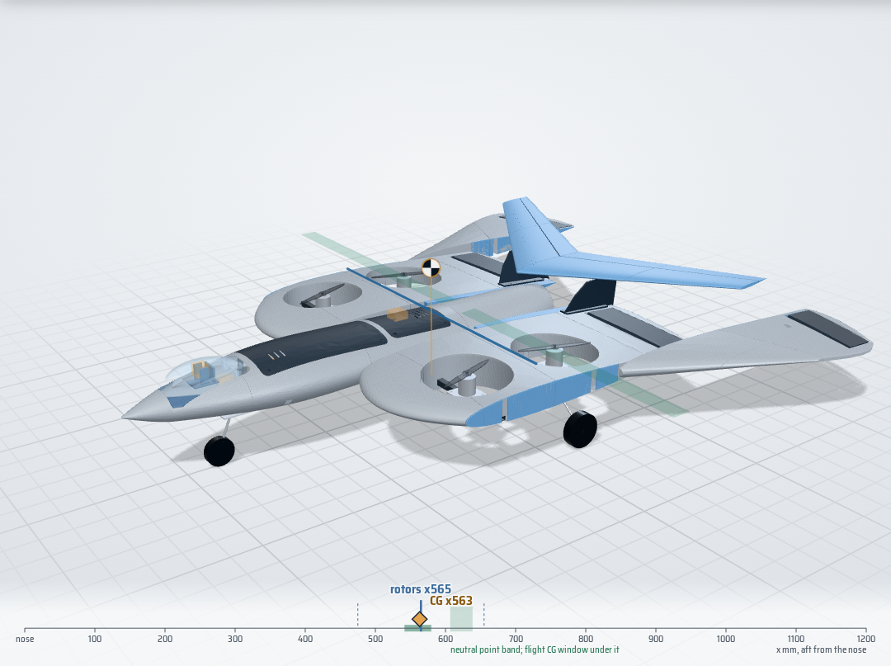
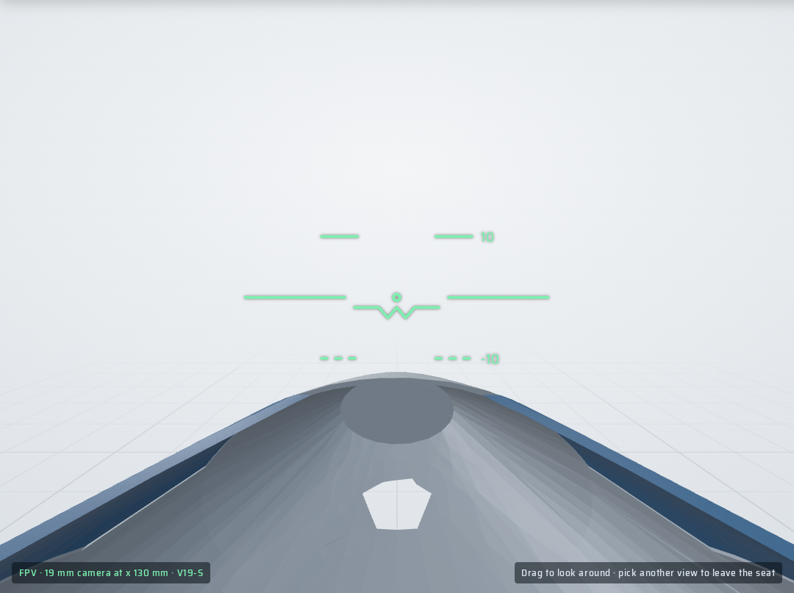
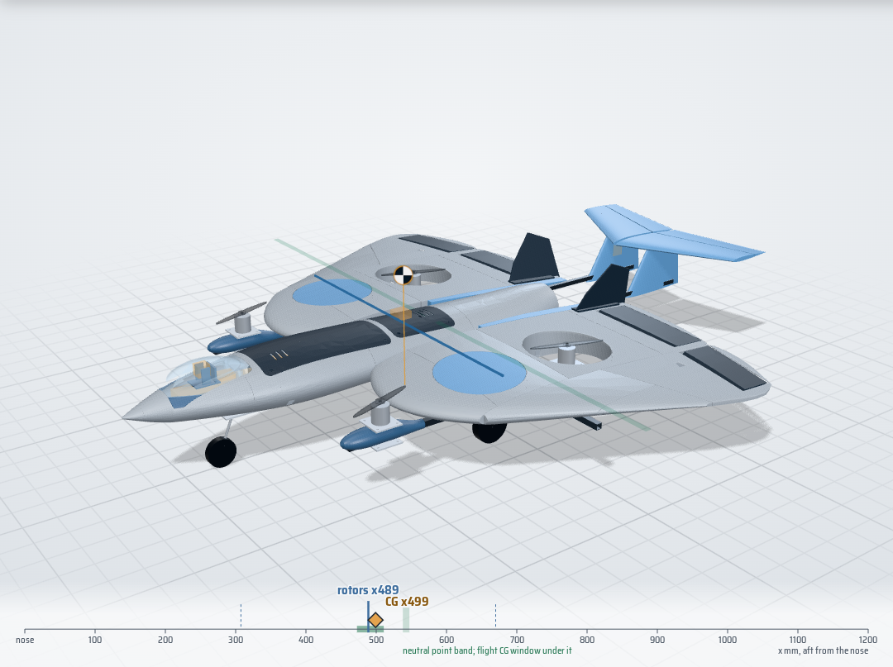
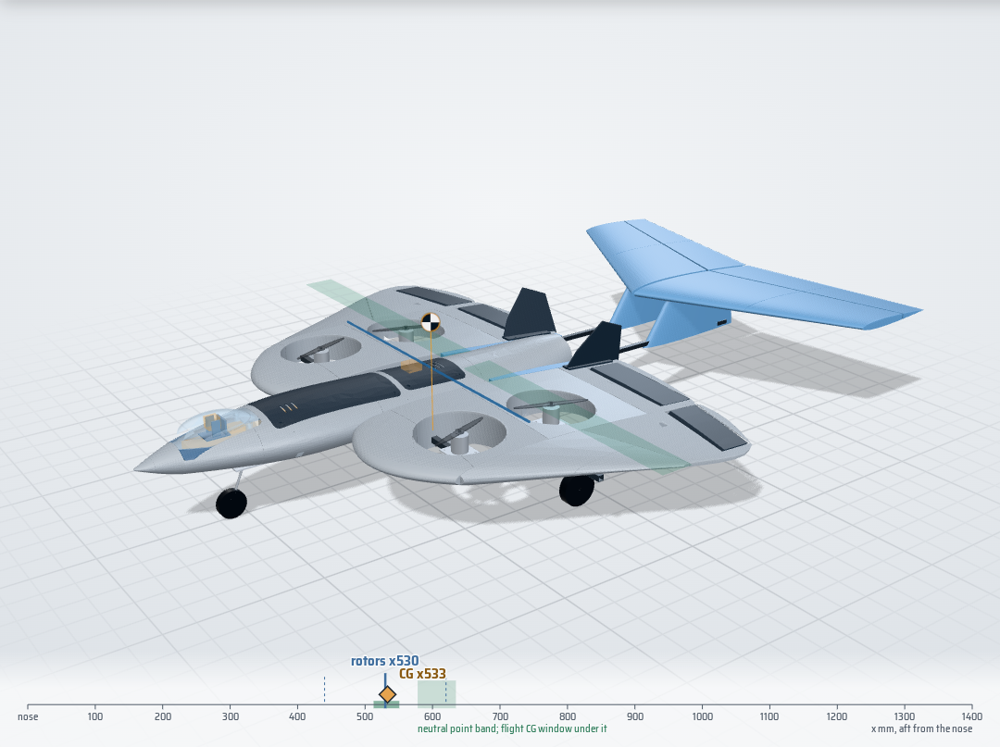

# V19 variants: long nose, falcon tail, forward rotors

> Screening results from the point-mass + vortex-lattice models, with the masses of the parts as the V19 geometry models them. Nothing has been built yet. Not a flight clearance: bench and fit gates in [TEST_GATES.md](TEST_GATES.md) still decide.

Your three directions, each built from your V18 assembly (`tools/v19/geometry.py`), collision-checked against V18 and evaluated with the same gates as V18: heaviest motor in hover no more than 30 % of the weight, static margin 5-25 % of the mean chord, pitch trim within 10 deg at 16 m/s, prop and flap clearances.

## The answer

|  | Mass g | CG x | Rotors x | Static margin % (wells closed / open) | Heaviest motor % | Trim 16 m/s deg | Length mm | New collisions | Gates |
|---|---:|---:|---:|---:|---:|---:|---:|---:|---:|
| V18 as designed | 2724 | 418 | 330 | -24.6 / -17.1 | 49.6 | 53.5 / 45.0 | 810 | - | STOP |
| V19-A | 2728 | 449 | 452 | -6.0 / 0.7 | 25.6 | 17.0 / 6.7 | 877 | 2 | STOP |
| V19-B | 2912 | 483 | 482 | -3.3 / 5.0 | 25.2 | -0.0 / -3.1 | 1188 | 1 | STOP |
| V19-C | 2883 | 480 | 480 | 7.4 / 8.7 | 25.0 | -6.0 / -8.4 | 952 | 0 | **PASS** |
| V19-R | 3006 | 499 | 489 | 7.1 / 8.8 | 26.5 | -4.4 / -5.7 | 1175 | 0 | **PASS** |
| V19-W | 3014 | 533 | 530 | 8.2 / 18.6 | 26.0 | -4.2 / -8.0 | 1355 | 0 | **PASS** |
| V19-S | 2832 | 563 | 565 | 8.0 / 13.9 | 25.5 | -1.7 / -8.1 | 1188 | 0 | **PASS** |

**Build V19-S.** It keeps everything you asked for in V19-W - all four lift motors in your V18 wing wells, the pilot's-eye FPV camera under a clear canopy, the single V18 EDF in the jet bay - and drops the big boom tail. Two changes do the tail's job instead. The outer falcon panels sweep 300 mm back at the wrist (a 'stoop', like a falcon tucking its wings in a dive), and a 0.07 m2 falcon crest sits on the tips of your own V18 fins, with no booms and no new fins. Without the tail weight to balance, the battery stays in the V18 tray and the nose bay goes. With the parts as modelled it weighs 2832 g (183 g less than V19-W), it is 168 mm shorter, its CG sits 2 mm from the rotor centroid, the heaviest motor carries 25.5 % in hover, and the static margin is 8.0 % to 13.9 %. V19-W (0.18 m2 boom tail), V19-R and V19-C also pass and stay as alternatives.

### Why each direction alone is not enough

- **Long nose alone (V19-A).** Moving the wing aft moves the neutral point aft almost one for one, but the CG only by the wing group's share of the mass. That helps, and the nose-bay battery helps more, yet at 200 mm the static margin is still -6.0 % and trim needs 17 deg of surface. Search rows: 150-200 mm, 0.6-0.8 g/cm3; none passes.
- **Falcon tail alone (V19-B).** A horizontal tail moves the neutral point aft without moving much mass, but on V18's short body it has a short arm. Even 0.15 m2 at a 120 mm wing shift leaves -3.3 %, and with the rotors balanced in the wing the rear crossrail lands in the D1 intake.
- **Forward rotors (V19-C, V19-R).** Taking the front pair out of the wing lets the rotors balance the CG without the wing having to move under them; V19-C passes at 275 mm, V19-R at 250 mm with a 0.05 m2 tail.
- **Four rotors in the wings (V19-W).** With the rotors fixed in your wells, the CG has to sit on their centroid, at wing station x 330. Your wing's own neutral point sits ahead of that station (x 285-332 on V18), so on its own the wing is unstable there; the tail is what moves the neutral point behind the CG. The tail's weight pulls the CG aft, so the wing moves 200 mm aft until the rotors sit under the CG again. The rear crossrail cannot follow the wells into the D1 intake, so it stops at x 566.5 and two short carbon booms under the wing carry the rear motors.

V19-W search (wing shift x tail area; tail leading edge 110 mm behind the wing root):

| Wing aft mm | Tail m2 | Static margin % | Heaviest motor % | Gates |
|---|---:|---:|---:|---:|
| 150 | 0.10 | -1.4 | 26.3 | - |
| 150 | 0.14 | 1.0 | 29.8 | - |
| 150 | 0.18 | 3.5 | 33.3 | - |
| 150 | 0.22 | 6.2 | 36.5 | - |
| 175 | 0.10 | 1.2 | 27.5 | - |
| 175 | 0.14 | 3.8 | 26.1 | - |
| 175 | 0.18 | 6.4 | 29.5 | PASS |
| 175 | 0.22 | 9.1 | 33.0 | - |
| 200 | 0.10 | 4.0 | 31.3 | - |
| 200 | 0.14 | 6.7 | 27.6 | PASS |
| 200 | 0.18 | 9.3 | 26.0 | PASS |
| 200 | 0.22 | 12.0 | 29.5 | PASS |
| 225 | 0.10 | 6.9 | 34.8 | - |
| 225 | 0.14 | 9.7 | 31.2 | - |
| 225 | 0.18 | 12.4 | 27.7 | PASS |
| 225 | 0.22 | 15.2 | 26.0 | - |
| 250 | 0.10 | 9.9 | 38.5 | - |
| 250 | 0.14 | 12.9 | 34.9 | - |
| 250 | 0.18 | 15.7 | 31.2 | - |
| 250 | 0.22 | 18.5 | 27.6 | - |

A smaller tail needs the wing further aft for hover balance but then loses margin; a bigger tail pulls the CG behind the rotors. The pick is the cheapest row with at least 7.5 % margin on the coarse lattice (it reads about 1 % high on tails) and no motor above 28 %.

- **No big tail (V19-S).** A tailless wing balanced on its rotors has about 0-1 % margin (the wing's neutral point sits right at the rotor station), so something has to add lift behind the CG. V19-S splits that job: the stoop moves the outer panels' lift 300 mm aft (about 1.6 % margin per 60 mm), and the crest adds a little tail lift high on the fins, right over the EDF instead of on booms behind it. A fixed crest (no elevator) needed 16-38 deg of elevon at 16 m/s with the wells open, outside the 10 deg gate, so the crest is set 4 deg leading edge down and has a 30 % elevator on one slim servo.

V19-S search (coarse lattice; wing shift x stoop x crest area; the last rows are fixed crests, kept for the record):

| Wing aft mm | Stoop mm | Crest m2 | Incidence deg | Elevator % | Static margin % | Heaviest motor % | Trim 16 m/s closed / open | Gates |
|---|---:|---:|---:|---:|---:|---:|---:|---:|
| 225 | 260 | 0.06 | -4 | 30 | 5.3 | 25.5 | 1.5 / -5.9 | PASS |
| 225 | 260 | 0.07 | -4 | 30 | 6.1 | 25.0 | 1.1 / -5.9 | PASS |
| 225 | 300 | 0.06 | -4 | 30 | 6.0 | 25.6 | 0.6 / -6.7 | PASS |
| 225 | 300 | 0.07 | -4 | 30 | 6.9 | 26.1 | 0.2 / -6.7 | PASS |
| 235 | 260 | 0.06 | -4 | 30 | 6.3 | 27.0 | 0.5 / -6.9 | PASS |
| 235 | 260 | 0.07 | -4 | 30 | 7.1 | 26.5 | 0.2 / -6.9 | PASS |
| 235 | 300 | 0.06 | -4 | 30 | 7.1 | 25.9 | -0.4 / -7.8 | PASS |
| 235 | 300 | 0.07 | -4 | 30 | 8.0 | 25.4 | -0.7 / -7.7 | PASS |
| 245 | 260 | 0.06 | -4 | 30 | 7.4 | 28.6 | -0.5 / -8.0 | PASS |
| 245 | 260 | 0.07 | -4 | 30 | 8.2 | 28.0 | -0.8 / -7.9 | PASS |
| 245 | 300 | 0.06 | -4 | 30 | 8.1 | 27.4 | -1.4 / -8.8 | PASS |
| 245 | 300 | 0.07 | -4 | 30 | 9.0 | 26.9 | -1.7 / -8.8 | PASS |
| 235 | 300 | 0.07 | 0 | 0 | 8.2 | 25.7 | -17.2 / -37.5 | - |
| 235 | 300 | 0.07 | -6 | 0 | 8.2 | 25.7 | 4.7 / -16.0 | - |

The pick is the cheapest passing row with at least 7.5 % margin on the coarse lattice (it reads about 1 % high), no motor above 28 % and at least 1.5 deg of the trim gate in hand. More stoop or more crest adds margin; more wing shift loads the front motors.

### Cruise engine: one EDF or two?

| Option | Static thrust | Current | Mass |  |
|---|---:|---:|---:|---:|
| One Freewing E7206 64 mm 12-blade, 4S (V18 choice) | 1200 g | 44 A | 142 g + 1 ESC | [spec](https://www.freewingmodel.com/747.html) |
| Two XFly Galaxy X5 50 mm 12-blade, 4S (each) | 1800 g | 80 A | 150 g + 2 ESCs | [spec](https://www.turbines-rc.com/en/xfly-galaxy/2967-edf-ducted-fan-xfly-galaxy-x5-xfly-model-50mm-12-blades-4s-motor-4600kv.html) |

**One EDF: keep the V18 E7206 in the jet bay.** It gives 0.42 thrust-to-weight for cruise (the lift rotors carry hover and transition), and it already fits the V18 saddles, the D1 intake and the D2 nozzle. It also draws about half the current of a twin, which matters on one 4S pack that is feeding four lift motors during transition. Twin 50 mm fans would add a second ESC and a split intake and nozzle. They would also make a sudden yaw moment if one fails, and give no lift redundancy, because hover is on the rotors. Revisit only if the Stage 2 bench shows the E7206 short of cruise thrust.

## V19-A long-nose falcon

_Wing group 200 mm aft, battery in a nose bay, rotors stay in the wing wells._ **Fails: static margin -6.0 % with the wells closed (needs 5 % or more): the CG is 35 mm behind the neutral point; pitch trim needs 17 deg of surface at 16 m/s; the rear crossrail runs into FIT_G10_EDF_outrigger_connector_-54; the rear crossrail runs into FIT_G10_EDF_outrigger_connector_54.**

What changes:

- Wing group 200 mm further aft of the nose: inner and falcon panels, flaps, elevons, fins and servo cassettes move together; nose, body, trays and EDF stay.
- Battery to a nose bay (pack centre x 157): 1.5 mm G10 floor on the keel tops, PETG rails; pack no larger than 136 x 44 x 31 mm; camera-cradle base trimmed 7 mm; lift C1 to reach the pack.
- Tray A slides 16 mm aft; FC with the VTX stacked on it, and the EDF ESC, move into its old battery pocket. Tray B stays as the receiver / spare bay.
- Both rotor pairs move -78 mm within the wing (crossrails with them): wells re-cut, the uncovered parts of the V18 wells filled.
- Leading-edge glove takes the inner-wing leading edge 82 mm forward (y 82-314) so the front wells keep 35 mm of wing ahead of them.
- F5 root fairings carry the wing-root profile past the end of the body to x 875.
- Pilot's-eye FPV camera: moved back to x 120-140, z 44 under a vacuum-formed clear PETG canopy on a printed canopy frame, on a PETG pilot-seat mount (tilt 0-25 deg).
- GPS/compass moves off the nose (it sat in the camera's view) to a mast pad on the H2 hatch, over Tray B.
- Cruise engine: the single V18 64 mm EDF (Freewing E7206) stays in the jet bay at the back.
- Main gear to x 496 (CG + 45 mm) and 1.5 mm lower.

| Mass | CG | Rotors front / rear | Neutral point closed / open | Hover g M1/M2/M3/M4 | 16 m/s alpha / surfaces deg | 20 m/s alpha / surfaces deg | Stall m/s (CLmax 0.9) |
|---|---:|---:|---:|---:|---:|---:|---:|
| 2728 g | x 449.3 | x 361.6 / 541.6 | x 414.1 / 453.7 | 700 / 665 / 699 / 665 | 7.8 / 17.0 | 5.2 / 13.6 | 9.7 |

New parts (208 g), STL in `cad/v19/v19a_long_nose/stl/`:

| Part | Material | g | Mass basis | P1S |
|---|---:|---:|---:|---:|
| `NEW_F5_root_fairing_L` | LW-PLA | 6.2 | V18 skin areal density x planform | fits |
| `NEW_F5_root_fairing_R` | LW-PLA | 6.2 | V18 skin areal density x planform | fits |
| `NEW_G10_nose_battery_floor` | G10 | 18.6 | volume x density | - |
| `NEW_canopy_clear_PETG` | PETG (clear sheet) | 15.3 | half the surface x 0.75 mm sheet | fits |
| `NEW_canopy_frame` | PETG | 1.5 | volume x density | fits |
| `NEW_cockpit_camera_seat` | PETG | 8.3 | volume x density | fits |
| `NEW_leading_edge_glove_L` | LW-PLA | 46.3 | V18 skin areal density x planform | fits |
| `NEW_leading_edge_glove_R` | LW-PLA | 46.3 | V18 skin areal density x planform | fits |
| `NEW_nose_battery_rails` | PETG | 7.8 | volume x density | fits |
| `NEW_well_fill_L` | LW-PLA | 25.6 | V18 skin areal density x planform | fits |
| `NEW_well_fill_R` | LW-PLA | 25.6 | V18 skin areal density x planform | fits |

Your V18 parts that change (concept variant: the cut panels are shown in the web viewer; files are exported only for V19-C, R and W):

- `WRA_hollow_wing`: re-cut rotor wells; slot for the crossrail at its new station; nose trimmed under the leading-edge glove
- `WRB_hollow_wing`: re-cut rotor wells; slot for the crossrail at its new station; nose trimmed under the leading-edge glove
- `WRC_hollow_wing`: re-cut rotor wells; slot for the crossrail at its new station
- `WLA_hollow_wing`: re-cut rotor wells; slot for the crossrail at its new station; nose trimmed under the leading-edge glove
- `WLB_hollow_wing`: re-cut rotor wells; slot for the crossrail at its new station; nose trimmed under the leading-edge glove
- `WLC_hollow_wing`: re-cut rotor wells; slot for the crossrail at its new station
- `WRE1_falcon_wing`: slot for the crossrail at its new station
- `WLE1_falcon_wing`: slot for the crossrail at its new station
- `WRE2_falcon_wing`: slot for the crossrail at its new station
- `WLE2_falcon_wing`: slot for the crossrail at its new station
- `F2_hollow_body`: slot for CF_crossrail_270_10x10x620 at x 361.6
- `F3_hollow_body`: slot for CF_crossrail_450_10x10x820 at x 541.6; slot for CF_gear_crossbar_10x10x340 at x 496.5

Checks: 2 new collisions against V18: `CF_crossrail_450_10x10x820` x `FIT_G10_EDF_outrigger_connector_-54`; `CF_crossrail_450_10x10x820` x `FIT_G10_EDF_outrigger_connector_54`; 14 intended contacts (clamps, sockets, bonded joints, listed in `cad/v19/v19a_long_nose/checks.json`).

## V19-B falcon tail

_Horizontal tail on twin swept fins at the ends of the EDF outrigger booms; wing 120 mm aft._ **Fails: static margin -3.3 % with the wells closed (needs 5 % or more): the CG is 18 mm behind the neutral point; the rear crossrail runs into the D1 belly intake.**

What changes:

- Wing group 120 mm further aft of the nose: inner and falcon panels, flaps, elevons, fins and servo cassettes move together; nose, body, trays and EDF stay.
- Battery to a nose bay (pack centre x 157): 1.5 mm G10 floor on the keel tops, PETG rails; pack no larger than 136 x 44 x 31 mm; camera-cradle base trimmed 7 mm; lift C1 to reach the pack.
- Tray A slides 16 mm aft; FC with the VTX stacked on it, and the EDF ESC, move into its old battery pocket. Tray B stays as the receiver / spare bay.
- Both rotor pairs move +32 mm within the wing (crossrails with them): wells re-cut, the uncovered parts of the V18 wells filled.
- Falcon tail: 0.150 m2 stabiliser, 693 mm span, 28 deg sweep, 80 mm above the wing plane on two swept fins; 35 % elevator, one servo in the starboard fin. The V18 EDF outriggers become one-piece 8 x 8 tail booms.
- Pilot's-eye FPV camera: moved back to x 120-140, z 44 under a vacuum-formed clear PETG canopy on a printed canopy frame, on a PETG pilot-seat mount (tilt 0-25 deg).
- GPS/compass moves off the nose (it sat in the camera's view) to a mast pad on the H2 hatch, over Tray B.
- Cruise engine: the single V18 64 mm EDF (Freewing E7206) stays in the jet bay at the back.
- Main gear to x 527 (CG + 45 mm) and 1.5 mm lower.

| Mass | CG | Rotors front / rear | Neutral point closed / open | Hover g M1/M2/M3/M4 | 16 m/s alpha / surfaces deg | 20 m/s alpha / surfaces deg | Stall m/s (CLmax 0.9) |
|---|---:|---:|---:|---:|---:|---:|---:|
| 2912 g | x 482.6 | x 392.1 / 572.1 | x 464.9 / 509.9 | 725 / 731 / 723 / 733 | 8.7 / -0.0 | 6.1 / -0.4 | 10.4 |

New parts (348 g), STL in `cad/v19/v19b_falcon_tail/stl/`:

| Part | Material | g | Mass basis | P1S |
|---|---:|---:|---:|---:|
| `KEEP_OUT_elevator_servo_23x12x26` | - | 17.0 | item | - |
| `NEW_CF_tail_boom_L_8x8x490` | carbon | 21.3 | length x g/m | - |
| `NEW_CF_tail_boom_R_8x8x490` | carbon | 21.3 | length x g/m | - |
| `NEW_CF_tail_spar_L_6x4x320` | carbon | 7.8 | length x g/m | - |
| `NEW_CF_tail_spar_R_6x4x320` | carbon | 7.8 | length x g/m | - |
| `NEW_G10_nose_battery_floor` | G10 | 18.6 | volume x density | - |
| `NEW_canopy_clear_PETG` | PETG (clear sheet) | 15.3 | half the surface x 0.75 mm sheet | fits |
| `NEW_canopy_frame` | PETG | 1.5 | volume x density | fits |
| `NEW_cockpit_camera_seat` | PETG | 8.3 | volume x density | fits |
| `NEW_nose_battery_rails` | PETG | 7.8 | volume x density | fits |
| `NEW_tail_elevator_L1` | LW-PLA | 16.1 | falcon-panel areal density x area | fits |
| `NEW_tail_elevator_L2` | LW-PLA | 12.0 | falcon-panel areal density x area | fits |
| `NEW_tail_elevator_R1` | LW-PLA | 16.1 | falcon-panel areal density x area | fits |
| `NEW_tail_elevator_R2` | LW-PLA | 12.0 | falcon-panel areal density x area | fits |
| `NEW_tail_fin_L` | LW-PLA | 17.7 | falcon-panel areal density x area | fits |
| `NEW_tail_fin_R` | LW-PLA | 17.7 | falcon-panel areal density x area | fits |
| `NEW_tail_stab_L1` | LW-PLA | 29.8 | falcon-panel areal density x area | fits |
| `NEW_tail_stab_L2` | LW-PLA | 22.3 | falcon-panel areal density x area | fits |
| `NEW_tail_stab_R1` | LW-PLA | 29.8 | falcon-panel areal density x area | fits |
| `NEW_tail_stab_R2` | LW-PLA | 22.3 | falcon-panel areal density x area | fits |
| `NEW_well_fill_L` | LW-PLA | 12.6 | V18 skin areal density x planform | fits |
| `NEW_well_fill_R` | LW-PLA | 12.6 | V18 skin areal density x planform | fits |

Your V18 parts that change (concept variant: the cut panels are shown in the web viewer; files are exported only for V19-C, R and W):

- `WRA_hollow_wing`: re-cut rotor wells
- `WRB_hollow_wing`: re-cut rotor wells; slot for the crossrail at its new station
- `WRC_hollow_wing`: re-cut rotor wells; slot for the crossrail at its new station
- `WLA_hollow_wing`: re-cut rotor wells
- `WLB_hollow_wing`: re-cut rotor wells; slot for the crossrail at its new station
- `WLC_hollow_wing`: re-cut rotor wells; slot for the crossrail at its new station
- `WRE1_falcon_wing`: slot for the crossrail at its new station
- `WLE1_falcon_wing`: slot for the crossrail at its new station
- `WRE2_falcon_wing`: slot for the crossrail at its new station
- `WLE2_falcon_wing`: slot for the crossrail at its new station
- `WRF_falcon_wing`: slot for the crossrail at its new station
- `WLF_falcon_wing`: slot for the crossrail at its new station
- `F2_hollow_body`: slot for CF_crossrail_270_10x10x620 at x 392.1
- `F3_hollow_body`: slot for CF_crossrail_270_10x10x620 at x 392.1; slot for CF_crossrail_450_10x10x820 at x 572.1; slot for CF_gear_crossbar_10x10x340 at x 527.0
- `F4_hollow_body`: slots where the tail booms leave the body

Checks: 1 new collisions against V18: `CF_crossrail_450_10x10x820` x `D1_belly_intake`; 21 intended contacts (clamps, sockets, bonded joints, listed in `cad/v19/v19b_falcon_tail/checks.json`).
 EDF jet: estimated jet edge 34 mm above the axis at the stabiliser, underside at z 67; the fins' inner faces (y 44) are outside the estimated jet edge (radius 32) at the fin leading edge. Estimate only: confirm with a tuft/streamer test on the EDF bench rig before the tail is glued.

## V19-C forward rotors

_Front rotors on booms ahead of the leading edge, wing 275 mm aft._ **Passes every model gate.**

What changes:

- Wing group 275 mm further aft of the nose: inner and falcon panels, flaps, elevons, fins and servo cassettes move together; nose, body, trays and EDF stay.
- Battery to a nose bay (pack centre x 157): 1.5 mm G10 floor on the keel tops, PETG rails; pack no larger than 136 x 44 x 31 mm; camera-cradle base trimmed 7 mm; lift C1 to reach the pack.
- Tray A slides 16 mm aft; FC with the VTX stacked on it, and the EDF ESC, move into its old battery pocket. Tray B stays as the receiver / spare bay.
- Front rotors on 10 x 10 carbon booms at y +/-220, PETG nose pods at x 265.5 (prop 82 mm ahead of the leading edge). Each boom runs under the wing to the rear motor and hangs from both crossrails.
- Rear motors stay in your V18 wells, on PETG risers on the boom. The front wells are closed with flush LW-PLA caps.
- Rear crossrail moves to x 566.5, ahead of the D1 intake: new slots in the panels and F3.
- F5 root fairings carry the wing-root profile past the end of the body to x 950.
- Pilot's-eye FPV camera: moved back to x 120-140, z 44 under a vacuum-formed clear PETG canopy on a printed canopy frame, on a PETG pilot-seat mount (tilt 0-25 deg).
- GPS/compass moves off the nose (it sat in the camera's view) to a mast pad on the H2 hatch, over Tray B.
- Cruise engine: the single V18 64 mm EDF (Freewing E7206) stays in the jet bay at the back.
- Main gear to x 526 (CG + 45 mm) and 1.5 mm lower.

| Mass | CG | Rotors front / rear | Neutral point closed / open | Hover g M1/M2/M3/M4 | 16 m/s alpha / surfaces deg | 20 m/s alpha / surfaces deg | Stall m/s (CLmax 0.9) |
|---|---:|---:|---:|---:|---:|---:|---:|
| 2883 g | x 480.4 | x 265.5 / 695.0 | x 520.6 / 527.9 | 720 / 721 / 720 / 722 | 12.6 / -6.0 | 8.3 / -1.3 | 10.3 |

New parts (244 g), STL in `cad/v19/v19c_forward_rotors/stl/`:

| Part | Material | g | Mass basis | P1S |
|---|---:|---:|---:|---:|
| `NEW_CF_rotor_boom_L_10x10x523` | carbon | 29.2 | length x g/m | - |
| `NEW_CF_rotor_boom_R_10x10x523` | carbon | 29.2 | length x g/m | - |
| `NEW_F5_root_fairing_L` | LW-PLA | 8.1 | V18 skin areal density x planform | fits |
| `NEW_F5_root_fairing_R` | LW-PLA | 8.1 | V18 skin areal density x planform | fits |
| `NEW_G10_nose_battery_floor` | G10 | 18.6 | volume x density | - |
| `NEW_boom_hanger_front_L` | PETG | 3.3 | volume x density | fits |
| `NEW_boom_hanger_front_R` | PETG | 3.3 | volume x density | fits |
| `NEW_boom_hanger_rear_L` | PETG | 3.3 | volume x density | fits |
| `NEW_boom_hanger_rear_R` | PETG | 3.3 | volume x density | fits |
| `NEW_canopy_clear_PETG` | PETG (clear sheet) | 15.3 | half the surface x 0.75 mm sheet | fits |
| `NEW_canopy_frame` | PETG | 1.5 | volume x density | fits |
| `NEW_cockpit_camera_seat` | PETG | 8.3 | volume x density | fits |
| `NEW_front_motor_pod_L` | PETG | 18.6 | surface x 1.2 mm wall | fits |
| `NEW_front_motor_pod_R` | PETG | 18.6 | surface x 1.2 mm wall | fits |
| `NEW_front_well_cap_lower_L` | LW-PLA | 11.5 | V18 skin areal density | fits |
| `NEW_front_well_cap_lower_R` | LW-PLA | 11.5 | V18 skin areal density | fits |
| `NEW_front_well_cap_upper_L` | LW-PLA | 11.5 | V18 skin areal density | fits |
| `NEW_front_well_cap_upper_R` | LW-PLA | 11.5 | V18 skin areal density | fits |
| `NEW_nose_battery_rails` | PETG | 7.8 | volume x density | fits |
| `NEW_rear_motor_riser_L` | PETG | 10.8 | volume x density | fits |
| `NEW_rear_motor_riser_R` | PETG | 10.8 | volume x density | fits |

Your V18 parts that change (modified STL beside the new parts, `*__V19.stl`):

- `WRB_hollow_wing`: slot for the relocated rear crossrail
- `WLB_hollow_wing`: slot for the relocated rear crossrail
- `WRE1_falcon_wing`: slot for the relocated rear crossrail
- `WLE1_falcon_wing`: slot for the relocated rear crossrail
- `F3_hollow_body`: slot for CF_crossrail_270_10x10x620 at x 515.0; slot for CF_crossrail_450_10x10x820 at x 566.5; slot for CF_gear_crossbar_10x10x340 at x 525.5

Checks: 0 new collisions against V18; 10 intended contacts (clamps, sockets, bonded joints, listed in `cad/v19/v19c_forward_rotors/checks.json`).

## V19-R boom rotors

_Long nose, forward rotors on booms and a small falcon tail; rear rotors stay in the V18 wells._ **Passes every model gate.**

What changes:

- Wing group 250 mm further aft of the nose: inner and falcon panels, flaps, elevons, fins and servo cassettes move together; nose, body, trays and EDF stay.
- Battery to a nose bay (pack centre x 157): 1.5 mm G10 floor on the keel tops, PETG rails; pack no larger than 136 x 44 x 31 mm; camera-cradle base trimmed 7 mm; lift C1 to reach the pack.
- Tray A slides 16 mm aft; FC with the VTX stacked on it, and the EDF ESC, move into its old battery pocket. Tray B stays as the receiver / spare bay.
- Front rotors on 10 x 10 carbon booms at y +/-220, PETG nose pods at x 307.5 (prop 15 mm ahead of the leading edge). Each boom runs under the wing to the rear motor and hangs from both crossrails.
- Rear motors stay in your V18 wells, on PETG risers on the boom. The front wells are closed with flush LW-PLA caps.
- Rear crossrail moves to x 566.5, ahead of the D1 intake: new slots in the panels and F3.
- Falcon tail: 0.050 m2 stabiliser, 400 mm span, 28 deg sweep, 80 mm above the wing plane on two swept fins; 35 % elevator, one servo in the starboard fin. The V18 EDF outriggers become one-piece 8 x 8 tail booms.
- F5 root fairings carry the wing-root profile past the end of the body to x 925.
- Pilot's-eye FPV camera: moved back to x 120-140, z 44 under a vacuum-formed clear PETG canopy on a printed canopy frame, on a PETG pilot-seat mount (tilt 0-25 deg).
- GPS/compass moves off the nose (it sat in the camera's view) to a mast pad on the H2 hatch, over Tray B.
- Cruise engine: the single V18 64 mm EDF (Freewing E7206) stays in the jet bay at the back.
- Main gear to x 544 (CG + 45 mm) and 1.5 mm lower.

| Mass | CG | Rotors front / rear | Neutral point closed / open | Hover g M1/M2/M3/M4 | 16 m/s alpha / surfaces deg | 20 m/s alpha / surfaces deg | Stall m/s (CLmax 0.9) |
|---|---:|---:|---:|---:|---:|---:|---:|
| 3006 g | x 499.1 | x 307.5 / 670.0 | x 537.9 / 547.2 | 710 / 793 / 707 / 796 | 11.8 / -4.4 | 8.0 / -2.4 | 10.5 |

New parts (384 g), STL in `cad/v19/v19r_boom_rotors/stl/`:

| Part | Material | g | Mass basis | P1S |
|---|---:|---:|---:|---:|
| `KEEP_OUT_elevator_servo_23x12x26` | - | 17.0 | item | - |
| `NEW_CF_rotor_boom_L_10x10x456` | carbon | 25.4 | length x g/m | - |
| `NEW_CF_rotor_boom_R_10x10x456` | carbon | 25.4 | length x g/m | - |
| `NEW_CF_tail_boom_L_8x8x547` | carbon | 23.7 | length x g/m | - |
| `NEW_CF_tail_boom_R_8x8x547` | carbon | 23.7 | length x g/m | - |
| `NEW_CF_tail_spar_L_6x4x185` | carbon | 4.5 | length x g/m | - |
| `NEW_CF_tail_spar_R_6x4x185` | carbon | 4.5 | length x g/m | - |
| `NEW_F5_root_fairing_L` | LW-PLA | 7.5 | V18 skin areal density x planform | fits |
| `NEW_F5_root_fairing_R` | LW-PLA | 7.5 | V18 skin areal density x planform | fits |
| `NEW_G10_nose_battery_floor` | G10 | 18.6 | volume x density | - |
| `NEW_boom_hanger_front_L` | PETG | 3.3 | volume x density | fits |
| `NEW_boom_hanger_front_R` | PETG | 3.3 | volume x density | fits |
| `NEW_boom_hanger_rear_L` | PETG | 3.3 | volume x density | fits |
| `NEW_boom_hanger_rear_R` | PETG | 3.3 | volume x density | fits |
| `NEW_canopy_clear_PETG` | PETG (clear sheet) | 15.3 | half the surface x 0.75 mm sheet | fits |
| `NEW_canopy_frame` | PETG | 1.5 | volume x density | fits |
| `NEW_cockpit_camera_seat` | PETG | 8.3 | volume x density | fits |
| `NEW_front_motor_pod_L` | PETG | 18.6 | surface x 1.2 mm wall | fits |
| `NEW_front_motor_pod_R` | PETG | 18.6 | surface x 1.2 mm wall | fits |
| `NEW_front_well_cap_lower_L` | LW-PLA | 11.5 | V18 skin areal density | fits |
| `NEW_front_well_cap_lower_R` | LW-PLA | 11.5 | V18 skin areal density | fits |
| `NEW_front_well_cap_upper_L` | LW-PLA | 11.5 | V18 skin areal density | fits |
| `NEW_front_well_cap_upper_R` | LW-PLA | 11.5 | V18 skin areal density | fits |
| `NEW_nose_battery_rails` | PETG | 7.8 | volume x density | fits |
| `NEW_rear_motor_riser_L` | PETG | 10.8 | volume x density | fits |
| `NEW_rear_motor_riser_R` | PETG | 10.8 | volume x density | fits |
| `NEW_tail_elevator_L` | LW-PLA | 9.3 | falcon-panel areal density x area | fits |
| `NEW_tail_elevator_R` | LW-PLA | 9.3 | falcon-panel areal density x area | fits |
| `NEW_tail_fin_L` | LW-PLA | 10.9 | falcon-panel areal density x area | fits |
| `NEW_tail_fin_R` | LW-PLA | 10.9 | falcon-panel areal density x area | fits |
| `NEW_tail_stab_L` | LW-PLA | 17.3 | falcon-panel areal density x area | fits |
| `NEW_tail_stab_R` | LW-PLA | 17.3 | falcon-panel areal density x area | fits |

Your V18 parts that change (modified STL beside the new parts, `*__V19.stl`):

- `WRB_hollow_wing`: slot for the relocated rear crossrail; slot for the rear boom hanger
- `WLB_hollow_wing`: slot for the relocated rear crossrail; slot for the rear boom hanger
- `WRE1_falcon_wing`: slot for the relocated rear crossrail
- `WLE1_falcon_wing`: slot for the relocated rear crossrail
- `F3_hollow_body`: slot for CF_crossrail_270_10x10x620 at x 490.0; slot for CF_crossrail_450_10x10x820 at x 566.5; slot for CF_gear_crossbar_10x10x340 at x 544.1
- `F4_hollow_body`: slots where the tail booms leave the body

Checks: 0 new collisions against V18; 26 intended contacts (clamps, sockets, bonded joints, listed in `cad/v19/v19r_boom_rotors/checks.json`).
 EDF jet: estimated jet edge 47 mm above the axis at the stabiliser, underside at z 73; the fins' inner faces (y 48) are outside the estimated jet edge (radius 45) at the fin leading edge. Estimate only: confirm with a tuft/streamer test on the EDF bench rig before the tail is glued.

## V19-W four rotors in the wings

_All four lift rotors in your V18 wing wells, wing 200 mm aft, falcon tail, pilot's-eye cockpit camera, one EDF._ **Passes every model gate.**

What changes:

- Wing group 200 mm further aft of the nose: inner and falcon panels, flaps, elevons, fins and servo cassettes move together; nose, body, trays and EDF stay.
- Battery to a nose bay (pack centre x 157): 1.5 mm G10 floor on the keel tops, PETG rails; pack no larger than 136 x 44 x 31 mm; camera-cradle base trimmed 7 mm; lift C1 to reach the pack.
- Tray A slides 16 mm aft; FC with the VTX stacked on it, and the EDF ESC, move into its old battery pocket. Tray B stays as the receiver / spare bay.
- All four lift motors stay in your V18 wing wells (the front pair back in the holes V19-R closes), on their V18 motor plates.
- Rear motors ride on PETG risers on two 10 x 10 carbon booms under the wing (y +/-220), hung from the front crossrail and from the rear crossrail, which moves to x 566.5 ahead of the D1 intake.
- Falcon tail: 0.180 m2 stabiliser, 759 mm span, 28 deg sweep, 80 mm above the wing plane on two swept fins; 35 % elevator, one servo in the starboard fin. The V18 EDF outriggers become one-piece 8 x 8 tail booms.
- F5 root fairings carry the wing-root profile past the end of the body to x 875.
- Pilot's-eye FPV camera: moved back to x 120-140, z 44 under a vacuum-formed clear PETG canopy on a printed canopy frame, on a PETG pilot-seat mount (tilt 0-25 deg).
- GPS/compass moves off the nose (it sat in the camera's view) to a mast pad on the H2 hatch, over Tray B.
- Cruise engine: the single V18 64 mm EDF (Freewing E7206) stays in the jet bay at the back.
- Main gear legs bolt to the rear motor backing plates under the booms at x 620 (about 87 mm behind the CG), track about 580 mm. The gear crossbar and G10 gear plates go: at CG + 45 mm the crossbar would sit behind the keels, in the D1 intake.

| Mass | CG | Rotors front / rear | Neutral point closed / open | Hover g M1/M2/M3/M4 | 16 m/s alpha / surfaces deg | 20 m/s alpha / surfaces deg | Stall m/s (CLmax 0.9) |
|---|---:|---:|---:|---:|---:|---:|---:|
| 3014 g | x 533.3 | x 440.0 / 620.0 | x 577.9 / 634.6 | 727 / 780 / 724 / 783 | 10.2 / -4.2 | 7.1 / -3.3 | 10.6 |

New parts (445 g), STL in `cad/v19/v19w_four_in_wings/stl/`:

| Part | Material | g | Mass basis | P1S |
|---|---:|---:|---:|---:|
| `KEEP_OUT_elevator_servo_23x12x26` | - | 17.0 | item | - |
| `NEW_CF_rotor_boom_L_10x10x245` | carbon | 13.7 | length x g/m | - |
| `NEW_CF_rotor_boom_R_10x10x245` | carbon | 13.7 | length x g/m | - |
| `NEW_CF_tail_boom_L_8x8x641` | carbon | 27.8 | length x g/m | - |
| `NEW_CF_tail_boom_R_8x8x641` | carbon | 27.8 | length x g/m | - |
| `NEW_CF_tail_spar_L_6x4x350` | carbon | 8.5 | length x g/m | - |
| `NEW_CF_tail_spar_R_6x4x350` | carbon | 8.5 | length x g/m | - |
| `NEW_F5_root_fairing_L` | LW-PLA | 6.2 | V18 skin areal density x planform | fits |
| `NEW_F5_root_fairing_R` | LW-PLA | 6.2 | V18 skin areal density x planform | fits |
| `NEW_G10_nose_battery_floor` | G10 | 18.6 | volume x density | - |
| `NEW_boom_hanger_front_L` | PETG | 2.4 | volume x density | fits |
| `NEW_boom_hanger_front_R` | PETG | 2.4 | volume x density | fits |
| `NEW_boom_hanger_rear_L` | PETG | 3.3 | volume x density | fits |
| `NEW_boom_hanger_rear_R` | PETG | 3.3 | volume x density | fits |
| `NEW_canopy_clear_PETG` | PETG (clear sheet) | 15.3 | half the surface x 0.75 mm sheet | fits |
| `NEW_canopy_frame` | PETG | 1.5 | volume x density | fits |
| `NEW_cockpit_camera_seat` | PETG | 8.3 | volume x density | fits |
| `NEW_nose_battery_rails` | PETG | 7.8 | volume x density | fits |
| `NEW_rear_motor_riser_L` | PETG | 10.8 | volume x density | fits |
| `NEW_rear_motor_riser_R` | PETG | 10.8 | volume x density | fits |
| `NEW_tail_elevator_L1` | LW-PLA | 19.3 | falcon-panel areal density x area | fits |
| `NEW_tail_elevator_L2` | LW-PLA | 14.4 | falcon-panel areal density x area | fits |
| `NEW_tail_elevator_R1` | LW-PLA | 19.3 | falcon-panel areal density x area | fits |
| `NEW_tail_elevator_R2` | LW-PLA | 14.4 | falcon-panel areal density x area | fits |
| `NEW_tail_fin_L` | LW-PLA | 19.3 | falcon-panel areal density x area | fits |
| `NEW_tail_fin_R` | LW-PLA | 19.3 | falcon-panel areal density x area | fits |
| `NEW_tail_stab_L1` | LW-PLA | 35.8 | falcon-panel areal density x area | fits |
| `NEW_tail_stab_L2` | LW-PLA | 26.8 | falcon-panel areal density x area | fits |
| `NEW_tail_stab_R1` | LW-PLA | 35.8 | falcon-panel areal density x area | fits |
| `NEW_tail_stab_R2` | LW-PLA | 26.8 | falcon-panel areal density x area | fits |

Your V18 parts that change (modified STL beside the new parts, `*__V19.stl`):

- `WRC_hollow_wing`: slot for the crossrail at its new station
- `WLC_hollow_wing`: slot for the crossrail at its new station
- `WRE1_falcon_wing`: slot for the crossrail at its new station
- `WLE1_falcon_wing`: slot for the crossrail at its new station
- `WRE2_falcon_wing`: slot for the crossrail at its new station
- `WLE2_falcon_wing`: slot for the crossrail at its new station
- `F3_hollow_body`: slot for CF_crossrail_270_10x10x620 at x 440.0; slot for CF_crossrail_450_10x10x820 at x 566.5
- `F4_hollow_body`: slots where the tail booms leave the body

Checks: 0 new collisions against V18; 25 intended contacts (clamps, sockets, bonded joints, listed in `cad/v19/v19w_four_in_wings/checks.json`).
 EDF jet: estimated jet edge 48 mm above the axis at the stabiliser, underside at z 66; the fins' inner faces (y 44) are inside the estimated jet edge (radius 46) at the fin leading edge. Estimate only: confirm with a tuft/streamer test on the EDF bench rig before the tail is glued.

## V19-S stoop wing + falcon crest

_All four lift rotors in your V18 wing wells, wing 235 mm aft, outer panels swept 300 mm back at the wrist, falcon crest on your V18 fins, battery in the V18 tray, pilot's-eye cockpit camera, one EDF._ **Passes every model gate.**

What changes:

- Wing group 235 mm further aft of the nose: inner and falcon panels, flaps, elevons, fins and servo cassettes move together; nose, body, trays and EDF stay.
- All four lift motors stay in your V18 wing wells (the front pair back in the holes V19-R closes), on their V18 motor plates.
- Rear motors ride on PETG risers on two 10 x 10 carbon booms under the wing (y +/-220), hung from the front crossrail and from the rear crossrail, which moves to x 566.5 ahead of the D1 intake.
- Falcon crest: a 0.070 m2 swept stabiliser (648 mm span, 35 deg sweep) bonded across the tips of your V18 fins at z 75, set 4 deg leading edge down; no booms and no new fins. The fins are trimmed to its underside. A 30 % chord elevator on one slim 5 g servo in the crest root shares the pitch trim with the elevons.
- F5 root fairings carry the wing-root profile past the end of the body to x 910.
- Stoop wing: the outer falcon panels, elevons and their servo cassettes sweep 300 mm aft at the wrist (the V18 seam at y 315), like a falcon tucking its wings in a dive. That moves the outer lift behind the CG. A swept 10 x 10 carbon wrist spar per side (219 mm, 52 deg) carries each outer panel, printed caps close the step, and the rear crossrail is shortened to 610 mm.
- Pilot's-eye FPV camera: moved back to x 120-140, z 44 under a vacuum-formed clear PETG canopy on a printed canopy frame, on a PETG pilot-seat mount (tilt 0-25 deg).
- GPS/compass moves off the nose (it sat in the camera's view) to a mast pad on the H2 hatch, over Tray B.
- Cruise engine: the single V18 64 mm EDF (Freewing E7206) stays in the jet bay at the back.
- Main gear legs bolt to the rear motor backing plates under the booms at x 655 (about 92 mm behind the CG), track about 580 mm. The gear crossbar and G10 gear plates go: at CG + 45 mm the crossbar would sit behind the keels, in the D1 intake.

| Mass | CG | Rotors front / rear | Neutral point closed / open | Hover g M1/M2/M3/M4 | 16 m/s alpha / surfaces deg | 20 m/s alpha / surfaces deg | Stall m/s (CLmax 0.9) |
|---|---:|---:|---:|---:|---:|---:|---:|
| 2832 g | x 563.1 | x 475.0 / 655.0 | x 606.8 / 638.6 | 722 / 694 / 723 / 693 | 12.7 / -1.7 | 8.5 / 0.9 | 10.2 |

New parts (250 g), STL in `cad/v19/v19s_stoop_crest/stl/`:

| Part | Material | g | Mass basis | P1S |
|---|---:|---:|---:|---:|
| `KEEP_OUT_crest_elevator_servo_20x18x9` | - | 10.0 | item | - |
| `NEW_CF_crest_spar_L_6x4x325` | carbon | 7.9 | length x g/m | - |
| `NEW_CF_crest_spar_R_6x4x325` | carbon | 7.9 | length x g/m | - |
| `NEW_CF_rotor_boom_L_10x10x245` | carbon | 13.7 | length x g/m | - |
| `NEW_CF_rotor_boom_R_10x10x245` | carbon | 13.7 | length x g/m | - |
| `NEW_CF_wrist_spar_L_10x10x219` | carbon | 12.2 | length x g/m | - |
| `NEW_CF_wrist_spar_R_10x10x219` | carbon | 12.2 | length x g/m | - |
| `NEW_F5_root_fairing_L` | LW-PLA | 7.1 | V18 skin areal density x planform | fits |
| `NEW_F5_root_fairing_R` | LW-PLA | 7.1 | V18 skin areal density x planform | fits |
| `NEW_boom_hanger_front_L` | PETG | 2.4 | volume x density | fits |
| `NEW_boom_hanger_front_R` | PETG | 2.4 | volume x density | fits |
| `NEW_boom_hanger_rear_L` | PETG | 3.3 | volume x density | fits |
| `NEW_boom_hanger_rear_R` | PETG | 3.3 | volume x density | fits |
| `NEW_canopy_clear_PETG` | PETG (clear sheet) | 15.3 | half the surface x 0.75 mm sheet | fits |
| `NEW_canopy_frame` | PETG | 1.5 | volume x density | fits |
| `NEW_cockpit_camera_seat` | PETG | 8.3 | volume x density | fits |
| `NEW_crest_L1` | LW-PLA | 15.7 | falcon-panel areal density x area | fits |
| `NEW_crest_L2` | LW-PLA | 10.7 | falcon-panel areal density x area | fits |
| `NEW_crest_R1` | LW-PLA | 15.7 | falcon-panel areal density x area | fits |
| `NEW_crest_R2` | LW-PLA | 10.7 | falcon-panel areal density x area | fits |
| `NEW_crest_elevator_L1` | LW-PLA | 6.7 | falcon-panel areal density x area | fits |
| `NEW_crest_elevator_L2` | LW-PLA | 4.6 | falcon-panel areal density x area | fits |
| `NEW_crest_elevator_R1` | LW-PLA | 6.7 | falcon-panel areal density x area | fits |
| `NEW_crest_elevator_R2` | LW-PLA | 4.6 | falcon-panel areal density x area | fits |
| `NEW_rear_motor_riser_L` | PETG | 10.8 | volume x density | fits |
| `NEW_rear_motor_riser_R` | PETG | 10.8 | volume x density | fits |
| `NEW_wrist_cap_inner_L` | LW-PLA | 7.5 | profile area x skin areal density | fits |
| `NEW_wrist_cap_inner_R` | LW-PLA | 7.5 | profile area x skin areal density | fits |
| `NEW_wrist_cap_outer_L` | LW-PLA | 4.9 | profile area x skin areal density | fits |
| `NEW_wrist_cap_outer_R` | LW-PLA | 4.9 | profile area x skin areal density | fits |

Your V18 parts that change (modified STL beside the new parts, `*__V19.stl`):

- `CF_crossrail_450_10x10x820`: shortened to 610 mm: the swept outer panels ride on wrist spars
- `WRC_hollow_wing`: slot for the swept wrist spar; slot for the rear boom hanger
- `WRD_hollow_wing`: slot for the swept wrist spar
- `WLC_hollow_wing`: slot for the swept wrist spar; slot for the rear boom hanger
- `WLD_hollow_wing`: slot for the swept wrist spar
- `WRE1_falcon_wing`: slot for the swept wrist spar
- `WLE1_falcon_wing`: slot for the swept wrist spar
- `WRE2_falcon_wing`: slot for the swept wrist spar
- `WLE2_falcon_wing`: slot for the swept wrist spar
- `WRB_hollow_wing`: slot for the crossrail at its new station; slot for the rear boom hanger
- `WLB_hollow_wing`: slot for the crossrail at its new station; slot for the rear boom hanger
- `F3_hollow_body`: slot for CF_crossrail_270_10x10x620 at x 475.0; slot for CF_crossrail_450_10x10x820 at x 566.5
- `FIN_R`: tip trimmed at z 68 (following the crest's incidence) to carry the crest
- `FIN_L`: tip trimmed at z 68 (following the crest's incidence) to carry the crest

Checks: 0 new collisions against V18; 31 intended contacts (clamps, sockets, bonded joints, listed in `cad/v19/v19s_stoop_crest/checks.json`).
 EDF jet: estimated jet edge 24 mm above the axis at the stabiliser, underside at z 68; the fins' inner faces (y 999) are outside the estimated jet edge (radius 44) at the fin leading edge. Estimate only: confirm with a tuft/streamer test on the EDF bench rig before the tail is glued.

## V19-S build changes

### Buy (in addition to the V18 BOM)

| Item (reference candidate) | Qty | USD |  |
|---|---:|---:|---:|
| Carbon square tube 10 x 10 x 1 mm, 1000 mm (cut 4 x 245 mm) | 1 | 8-18 each | [link](https://www.amazon.com/s?k=carbon+fiber+square+tube+10mm) |
| Carbon round tube 6 x 4 mm, 1000 mm (cut 2 x 325 mm) | 1 | 8-18 each | [link](https://www.amazon.com/s?k=carbon+fiber+tube+6mm+4mm) |
| Crest elevator servo, slim 5 g wing servo, about 20 x 18 x 9 mm (reference class: Hitec HS-40) | 1 | 15-25 | [link](https://www.amazon.com/s?k=hitec+hs-40+servo) |
| Elevator torque rod, horn and clevis set (1.2 mm wire) | 1 | 6-10 | [link](https://www.amazon.com/s?k=rc+pushrod+clevis+control+horn+set) |
| Clear PETG sheet 0.75 mm, A4 or larger (vacuum-formed canopy; two spares) | 3 | 8-15 | [link](https://www.amazon.com/s?k=petg+sheet+0.75mm+clear) |
| M3 U-straps / saddle clamps for 10 mm tube, plus M3 hardware | 8 | 8-14 | [link](https://www.amazon.com/s?k=m3+u+bolt+10mm) |
| M2 x 6 screws and washers (camera tilt) | 4 | 2-5 | [link](https://www.amazon.com/s?k=m2+x+6+screws) |

Not added to `bom/bom.csv` on purpose: that file is the V18 budget. Fold these rows in when V19-S becomes the build.

### Carbon and G10 cut list

| Part | Material | Size |
|---|---:|---:|
| `NEW_CF_wrist_spar_R_10x10x219` | carbon | 10x10 section, 219 mm long |
| `NEW_CF_wrist_spar_L_10x10x219` | carbon | 10x10 section, 219 mm long |
| `NEW_CF_rotor_boom_R_10x10x245` | carbon | 10x10 section, 245 mm long |
| `NEW_CF_rotor_boom_L_10x10x245` | carbon | 10x10 section, 245 mm long |
| `NEW_CF_crest_spar_R_6x4x325` | carbon | 6x4 section, 325 mm long |
| `NEW_CF_crest_spar_L_6x4x325` | carbon | 6x4 section, 325 mm long |

### Print

| Part | Material | P1S | Notes |
|---|---:|---:|---:|
| `NEW_canopy_frame` | PETG | fits | Lower 12 mm of your C1 cover printed as the canopy frame: it carries the latches and the camera seat, and the clear canopy bonds to its lip. |
| `NEW_canopy_clear_PETG` | PETG (clear sheet) | fits | Vacuum-formed 0.75 mm clear PETG sheet over a buck printed from the C1 shape (printed clear filament is only translucent). Trim to the frame lip. |
| `NEW_cockpit_camera_seat` | PETG | fits | Pilot-seat camera mount: 19 mm micro FPV camera between two cheeks on M2 screws (0-25 deg uptilt), seat back behind it; screws to the canopy frame so lifting the canopy opens the nose bay. |
| `NEW_wrist_cap_inner_R` | LW-PLA | fits | Closes the inner panel's tip face ahead of the swept-back outer panel (the falcon 'wrist'). |
| `NEW_wrist_cap_inner_L` | LW-PLA | fits | Closes the inner panel's tip face ahead of the swept-back outer panel (the falcon 'wrist'). |
| `NEW_wrist_cap_outer_R` | LW-PLA | fits | Closes the outer panel's root face behind the inner panel's trailing edge. |
| `NEW_wrist_cap_outer_L` | LW-PLA | fits | Closes the outer panel's root face behind the inner panel's trailing edge. |
| `NEW_F5_root_fairing_R` | LW-PLA | fits | Fills the gap between F4 and the wing root, and carries the root profile past the end of the body to the wing trailing edge (x 910). |
| `NEW_F5_root_fairing_L` | LW-PLA | fits | Fills the gap between F4 and the wing root, and carries the root profile past the end of the body to the wing trailing edge (x 910). |
| `NEW_boom_hanger_front_R` | PETG | fits | PETG spacer between the front crossrail and the boom, two M3 U-straps round each tube. |
| `NEW_boom_hanger_rear_R` | PETG | fits | PETG spacer between the rear crossrail and the boom, two M3 U-straps round each tube. |
| `NEW_rear_motor_riser_R` | PETG | fits | Hollow PETG riser (1.6 mm walls) from the boom to the V18 rear motor plate. |
| `NEW_boom_hanger_front_L` | PETG | fits | PETG spacer between the front crossrail and the boom, two M3 U-straps round each tube. |
| `NEW_boom_hanger_rear_L` | PETG | fits | PETG spacer between the rear crossrail and the boom, two M3 U-straps round each tube. |
| `NEW_rear_motor_riser_L` | PETG | fits | Hollow PETG riser (1.6 mm walls) from the boom to the V18 rear motor plate. |
| `NEW_crest_R1` | LW-PLA | fits | Falcon crest: swept stabiliser (NACA 0009, 35 deg leading-edge sweep) bonded across the tips of your V18 fins at 4 deg leading-edge-down incidence. Piece 1 of 2, inboard first. |
| `NEW_crest_elevator_R1` | LW-PLA | fits | Crest elevator, 30 % chord, halves joined by a wire torque rod at the centre; one slim servo in the crest root. Piece 1 of 2, inboard first. |
| `NEW_crest_R2` | LW-PLA | fits | Falcon crest: swept stabiliser (NACA 0009, 35 deg leading-edge sweep) bonded across the tips of your V18 fins at 4 deg leading-edge-down incidence. Piece 2 of 2, inboard first. |
| `NEW_crest_elevator_R2` | LW-PLA | fits | Crest elevator, 30 % chord, halves joined by a wire torque rod at the centre; one slim servo in the crest root. Piece 2 of 2, inboard first. |
| `NEW_crest_L1` | LW-PLA | fits | Falcon crest: swept stabiliser (NACA 0009, 35 deg leading-edge sweep) bonded across the tips of your V18 fins at 4 deg leading-edge-down incidence. Piece 1 of 2, inboard first. |
| `NEW_crest_elevator_L1` | LW-PLA | fits | Crest elevator, 30 % chord, halves joined by a wire torque rod at the centre; one slim servo in the crest root. Piece 1 of 2, inboard first. |
| `NEW_crest_L2` | LW-PLA | fits | Falcon crest: swept stabiliser (NACA 0009, 35 deg leading-edge sweep) bonded across the tips of your V18 fins at 4 deg leading-edge-down incidence. Piece 2 of 2, inboard first. |
| `NEW_crest_elevator_L2` | LW-PLA | fits | Crest elevator, 30 % chord, halves joined by a wire torque rod at the centre; one slim servo in the crest root. Piece 2 of 2, inboard first. |

All printed parts in one file: `cad/v19/v19s_stoop_crest/v19s_stoop_crest_print_set.3mf` (unsliced; outer mould lines - print the LW-PLA parts hollow with your V18 wing settings). The clear canopy is vacuum-formed, not printed: print the `NEW_canopy_clear_PETG` shape solid as the forming buck.

### Gates to add before the first hover

- Rear booms: with each rear motor at 50 % throttle on the stand, no visible riser or boom vibration; tap test each clamp.
- Wrist spars: with the aircraft held at the wing roots, hang 1.5 kg (about 2.5 g of manoeuvre load on one outer panel) from each outer panel's mid-span for one minute; no creak, no visible joint movement, no skin cracking at the wrist caps.
- EDF jet on the crest: tuft the crest underside and the fin tops, run the EDF to 100 % on the bench; no tuft should stream aft.
- Crest elevator: +/-20 deg throw with no contact against the fin tops; the slim servo centres within 1 deg.
- Cockpit camera: the FPV image shows the horizon with the nose in the lower edge at 0-10 deg uptilt; no canopy glare at the sun angles you fly in (matt black seat and frame).
- Weigh and balance the complete aircraft: CG within 5 mm of x 563 before any hover.
- Trim: at 16 m/s the model needs 13 deg of angle of attack; plan transitions and cruise at 18-20 m/s (8 deg at 20 m/s) and confirm the stall speed (model 10.2 m/s at CLmax 0.9) in the glide tests.

## How the numbers were made

- `tools/v19/search.py` ran 78 configurations across six families. In families A-C and R the rotors are placed so their centroid sits on that configuration's CG within the geometric limits (in W and S they stay in your V18 wells and the wing shift, stoop and tail decide the balance), the masses come from the V19 construction (`geometry.py` mass-only mode), and the neutral points come from the vortex lattice with the wells closed and open. The cheapest passing configuration in each family becomes `config/v19/<variant>.json`.
- `tools/v19/geometry.py` builds each variant from the V18 meshes, cuts the V18 parts that must change, generates the new parts, runs a full-assembly collision check against the V18 baseline, and re-evaluates with the mass of every part where it sits (`cad/v19/<variant>/mass_inputs.json`).
- Assumptions to replace with measurements: LW-PLA at 0.80 g/cm3, new skins at the V18 skin areal density (1407 g/m2 for both skins), tail surfaces at the V18 falcon-panel density (1100 g/m2), PETG parts solid or at the stated wall, EDF jet spread 0.1 mm per mm from a 30 mm exit radius. Not counted: the 43 g of distributed fasteners and consumables stay at their V18 position, and longer motor leads, the elevator servo and camera leads and the boom U-straps (about 30-40 g, mostly aft of the CG, roughly -0.4 % static margin) are not modelled yet. Props are excluded from the collision check; the prop disc to leading-edge clearance is checked separately.
- Regenerate everything: `make v19` (search + geometry + this document + web data).

