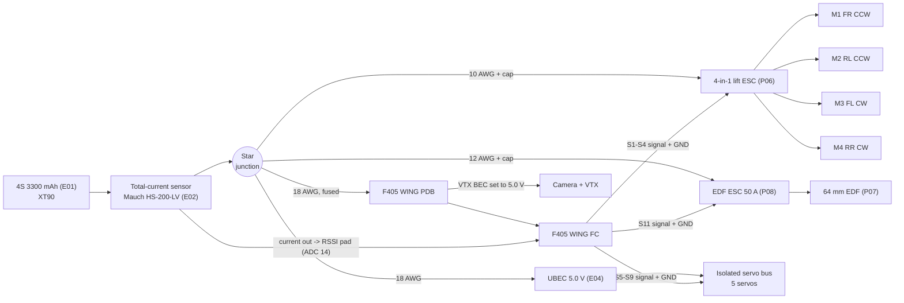

# Wiring - pin by pin, per module

Status: **PROTOTYPE-READY for props-OFF bench bring-up (Stage 8). Not flight-approved.**
Every pad name below must be re-checked against the silk screen of the part you actually hold and
against the firmware you actually load. Where this document names a signal rather than a pin
position (for example on a 4-in-1 harness), use the silk label - do not count pins.

Board reference: original full-size SpeedyBee F405 WING APP (not MINI) running ArduPilot Plane, target `SpeedyBeeF405WING`.
Facts used from the ArduPilot hwdef/readme: UART1 = serial RC, UART3 = GPS, 12 PWM outputs in timer
groups 1-2 / 3-4 / 5-7 / 8-10 / 11-12, ADC 10 = battery volts, ADC 11 = PDB current,
ADC 14 = RSSI pad, ADC 15 = analog-airspeed pad, buzzer on GPIO 80, I2C1 for compass/airspeed.
PDB: 90 A cont / 215 A peak shunt, FC BEC 5 V 2.4 A, VTX BEC 9 V / 12 V / 5 V 1.8 A,
servo (Vx) BEC 4.9 / 6 / 7.2 V 4.5 A. The FC ADC pins are unscaled 3.3 V inputs.

## 0. System map

Rule set that every table below follows:

1. One battery, one star. All high-current returns go to the star, never through signal grounds.
2. Regulator positives are never paralleled: FC BEC, VTX BEC, servo Vx BEC, UBEC, the 4-in-1's
   5 V BEC and the EDF ESC's BEC each feed their own load or nothing.
3. Every ESC and servo signal has its own signal-ground reference wire back to the FC.
4. The total-current sensor sits between the battery and the star, so it sees lift + EDF + avionics.
5. Nothing gets 5 V until that rail has been MEASURED at 5.0 V (+/- 0.2 V) with a meter.

## 1. Battery, total-current sensor and star distribution

| # | From (connector / pad) | To | Wire | Notes |
|---|---|---|---|---|
| 1.1 | Battery + (XT90 female, aircraft side) | Sensor IN + | 10 AWG, shortest possible | Pack ships XT60/12 AWG: re-terminate only after the Stage-2 current gate says so |
| 1.2 | Battery - | Star ground directly | 10 AWG | The HS-200-LV sits in the + lead (it ships with two red 10 AWG leads) |
| 1.3 | Sensor OUT + | Star + | 10 AWG | Star = soldered splice or bus bar, heat-shrunk and strain-relieved |
| 1.4 | Star + / star - | 4-in-1 ESC VBAT / GND pads | 10 AWG pair (branch A) | Cap E07 #1 soldered across these pads, leads < 20 mm |
| 1.5 | Star + / star - | EDF ESC battery leads via XT60 | 12 AWG pair (branch B) | Cap E07 #2 at the ESC input. EDF branch unplugged during all other work |
| 1.6 | Star + (via fuse E08) / star - | F405 WING PDB battery pads | 18 AWG pair (branch C) | PDB shunt now measures only this branch (BATT2) |
| 1.7 | Star + / star - | UBEC input | 18 AWG pair (branch D) | |

Gauges are starting points; the final gauge comes from the measured Stage-2/Stage-9 current in
`docs/BUDGET.md`.

## 2. Total-current sensor signal (Mauch HS-200-LV, DF13-6)

The pin order below is the common Pixhawk power-port convention. **Confirm it against the Mauch test
sheet that ships with your sensor before soldering.**

| Sensor pin | Signal | FC pad | Wire | Notes |
|---|---|---|---|---|
| 1 | VCC | FC 5 V pad | 26 AWG | Powered from the FC 5 V BEC only - do NOT also fit a Mauch BEC (no paralleled regulators) |
| 2 | VCC | (tied to pin 1) | - | |
| 3 | Current out | **RSSI pad** (PC4, ADC 14) | 26 AWG | Must stay <= 3.3 V at max expected current. `BATT_CURR_PIN,14` |
| 4 | Voltage out | not connected | - | Battery voltage comes from the PDB (ADC 10). Airspeed-analog pad (ADC 15) stays spare |
| 5 | GND | FC GND | 26 AWG | |
| 6 | GND | (tied to pin 5) | - | |

RSSI comes from the ELRS link (`RSSI_TYPE,3`), which is why the RSSI pad is free.

## 3. F405 WING power and FC pads

| FC / PDB pad | Connects to | Notes |
|---|---|---|
| PDB BAT+ / BAT- | Branch C (1.6) | Fused |
| VTX BEC out (9 V / 12 V / 5 V selectable) | Video rail (section 9) | **Set to 5 V and measure before connecting anything** - 9 V destroys the TX200U-US. Output is switchable on GPIO 81; confirm it is ON at boot |
| Servo Vx BEC rail (+) | **Nothing** | The servo header + pins are left unused because servos run on the isolated UBEC bus |
| FC 5 V (2.4 A BEC) | Receiver, GNSS, airspeed, current-sensor VCC | Sum of these loads is well under 1 A |
| BZ+ / BZ- | Lost-model alarm (section 11) | |
| LED / S12 | Not used | `SERVO12_FUNCTION,0` |

## 4. Lift ESC (Hobbywing XRotor Micro 60A 4-in-1) and motors

| # | ESC pad / signal | To | Notes |
|---|---|---|---|
| 4.1 | M1 signal | FC **S1** | Motor1, front-right, CCW |
| 4.2 | M2 signal | FC **S2** | Motor2, rear-left, CCW |
| 4.3 | M3 signal | FC **S3** | Motor3, front-left, CW |
| 4.4 | M4 signal | FC **S4** | Motor4, rear-right, CW |
| 4.5 | Signal GND | FC GND next to S1-S4 | 26 AWG reference only - carries no motor current |
| 4.6 | CURR (current out) | not connected | Total current is measured by E02 |
| 4.7 | TLM (telemetry) | optional: FC **R4** (UART4 RX), `SERIAL4_PROTOCOL,16` | Only after PWM bring-up passes |
| 4.8 | ESC 5 V BEC pad | not connected | No paralleled regulators |
| 4.9 | Phase outputs A/B/C per channel | Motor 3-wire leads | Direction fixed in BLHeli_32 or by swapping any two phases |

The ESC's own M1-M4 pad numbering is **not** assumed to match ArduPilot's geometry. At Stage 8, props
OFF, run the ArduPilot motor test: A must spin the front-right motor (M1), B rear-right (M4), C
rear-left (M2), D front-left (M3), each in its listed direction. Re-map wiring (not parameters) until it does.

## 5. EDF ESC (Hobbywing Skywalker 60A V2) and EDF (Freewing E7206 64 mm Mark II)

| # | ESC wire | To | Notes |
|---|---|---|---|
| 5.1 | Battery red/black | Branch B via XT60 | Cap at input |
| 5.2 | Signal (white/yellow) | FC **S11** signal pin | `SERVO11_FUNCTION,70` |
| 5.3 | Signal ground (brown/black) | FC **S11** ground pin | |
| 5.4 | BEC red (centre pin) | **Isolated** - pin extracted and insulated | Never connected to any rail |
| 5.5 | Motor 3 x 3.5 mm bullets | EDF motor | Direction checked with the EDF **outside the aircraft** and the inlet guarded |

## 6. Servos and the isolated servo bus

A small perfboard breakout (A11) carries five 3-pin headers. Signal pins come from the FC; + and - come
from the UBEC. One 22 AWG link joins bus - to FC GND so the signals share a reference.

| Bus header | Signal from FC | Servo | + / - from | `SERVOx_FUNCTION` |
|---|---|---|---|---|
| H1 | **S5** | Left elevon | UBEC 5.0 V / GND | 77 |
| H2 | **S6** | Right elevon | UBEC 5.0 V / GND | 78 |
| H3 | **S7** | Left flap | UBEC 5.0 V / GND | 2 |
| H4 | **S8** | Right flap | UBEC 5.0 V / GND | 2 (reverse at calibration if mirrored) |
| H5 | **S9** | Nose steering | UBEC 5.0 V / GND | 26 |
| - | - | UBEC - -> bus - -> FC GND | single 22 AWG link | reference only |

FC-to-bus ribbon: 6 wires (S5, S6, S7, S8, S9, GND). The FC servo-header + pins are not connected.
Elevon mixing is done by the FC; the transmitter sends plain roll/pitch.

## 7. Receiver (RadioMaster RP1 V2, CRSF, U.FL antenna)

| RP1 pad | FC pad | Notes |
|---|---|---|
| 5V | FC 5 V | |
| GND | FC GND | |
| TX | **R1** | `SERIAL1_PROTOCOL,23` |
| RX | **T1** | |

## 8. GNSS + compass (UART M10 + I2C compass, V18 case <= 26 x 26 x 13) and airspeed (Matek ASPD-4525)

| Module pin | FC pad | Notes |
|---|---|---|
| GNSS 5V | FC 5 V | Check the module's own pin order - modules differ; match by signal name |
| GNSS GND | FC GND | |
| GNSS TX | **R3** | `SERIAL3_PROTOCOL,5` |
| GNSS RX | **T3** | |
| GNSS SDA | FC **SDA** (I2C1) | Compass QMC5883L |
| GNSS SCL | FC **SCL** (I2C1) | |
| ASPD 5V / GND | FC I2C connector 5 V / GND | |
| ASPD SDA / SCL | FC **SDA / SCL** (shared bus) | `ARSPD_TYPE,1`; check both devices appear in the boot I2C scan; add no extra pull-ups unless a scan fails |

## 9. FPV video (RunCam Phoenix 2 + 5 V VTX, TX200U-US electrical reference)

| # | From | To | Notes |
|---|---|---|---|
| 9.1 | Video rail 5.0 V (FC VTX BEC set to 5 V, measured) | VTX 5 V input (TX200U-US: "3.5-5.5V in") | Camera accepts 5-36 V, the VTX only 3.5-5.5 V - hence one measured 5 V rail |
| 9.2 | Video rail 5.0 V | Phoenix 2 V+ | |
| 9.3 | Video rail GND | VTX GND + camera GND | |
| 9.4 | Camera VIDEO | VTX VIDEO IN | Direct. Optional later: route through the FC's analog OSD pads if you want on-screen current/voltage (verify the board's OSD support first) |
| 9.5 | VTX "5V out" | not connected | |
| 9.6 | VTX button wire | not connected (use on-board button) | |
| 9.7 | Antenna (U.FL) | **Attached before any power** | |

## 10. Where everything sits (V18 positions)

From the V18 keep-out boxes (x aft from the nose, y starboard, mm). Wire lengths for every run are in
[`HARNESS.md`](HARNESS.md).

| Module | V18 envelope | Centre (x, y) | Tray |
|---|---|---|---|
| 4-in-1 lift ESC | 54 x 46 x 14 | (254, -25) | TRAY_A front-left |
| Servo UBEC | 48 x 38 x 16 | (254, +27) | TRAY_A front-right |
| Battery | 140 x 50 x 38 | (362, 0) | TRAY_A main bay |
| Flight controller | 54 x 34 x 24 | (486, -17) | TRAY_B left |
| VTX | 42 x 26 x 14 | (488, +30) | TRAY_B right |
| EDF ESC | 73 x 30 x 12 + margin | (538, 0) | TRAY_B aft |
| Camera | 19 mm | (103, 0) | CAM_19mm_cradle |
| RX antenna zone | 24 x 20 x 10 | (168, 0) | nose, keep clear of carbon |
| GNSS (external) | 26 x 26 x 13 | (52, 0) | nose top, nonconductive pad |
| EDF housing | 72 dia x 78 | (710, 0) | EDF_saddle x2 |
| Servos | SP1 cassettes | (566, +/-180), (527, +/-360) | wing |
| Star point, current sensor, servo bus, airspeed, buzzer, steering servo | - | assumed | not placed in V18 |

The 4-in-1 sits front-left while the rear motors are 420 mm aft: every lift-motor lead needs an extension
(292-524 mm, see HARNESS.md).

## 11. Ground scheme summary

- Power grounds: battery -> sensor -> star -> each branch. Nothing else carries propulsion current.
- Signal grounds: FC GND -> 4-in-1 signal GND, EDF ESC signal GND, servo-bus GND link, RX, GNSS, ASPD,
  current sensor. All thin (22-26 AWG) so that a missing power return blows a thin wire instead of
  silently routing motor current through the FC.
- The FC and video grounds already return to the star via the PDB branch.

## 12. Lost-model alarm and arming discipline

| Alarm wire | FC pad |
|---|---|
| + | BZ+ |
| - | BZ- |

Arming discipline (write it on the transmitter case):

1. Props OFF for every bench session until Stage 10.
2. Alarm chirps at power-up; if it does not, do not arm.
3. EDF branch unplugged unless the EDF is the thing being tested.
4. Arm only with the aircraft restrained and people behind the rotor planes.
5. Disarm, then unplug the battery, before touching anything.

## 13. Stage-8 bring-up order (props OFF) and what to measure

| Step | Connect | Measure / check | PASS |
|---|---|---|---|
| 1 | Battery -> sensor -> star, all branches unplugged | Continuity, no short, polarity at every branch plug | Correct polarity, > 1 kOhm between + and - |
| 2 | Branch C (PDB) only, no peripherals | FC 5 V, VTX BEC (set to 5 V) | 5.0 +/- 0.2 V on both |
| 3 | Branch D (UBEC) only | UBEC output loaded with one servo | 5.0 +/- 0.2 V |
| 4 | RX, GNSS, ASPD, current sensor | Boot log, I2C scan, BATT/BATT2 readings | Devices detected; BATT current ~0 A with propulsion unplugged |
| 5 | Servos one at a time, then all five moving together | UBEC voltage while all five move | No dip below 4.8 V, no FC reboot |
| 6 | Camera + VTX (antenna on) | Video on screen, VTX temperature after 5 min | Clean image, VTX hand-warm |
| 7 | Branch A (4-in-1), motors without props | Motor test A-D order + direction | Matches section 4 |
| 8 | Branch B (EDF) with EDF guarded, outside the airframe | Direction, BATT current reading vs inline meter | Direction correct; E02 within 5% of meter |
| 9 | Everything together | Brownout check: servos sweeping while motors spin up | No reboot, no video loss |

Log every measured voltage in `config/measurements.json` (and in your build notes).

## 14. Pitch-authority note (EXPERIMENTAL, after the CG is fixed)

The vortex-lattice model (`analysis/aero.json`) shows the outer elevons alone need about -13 to -18 deg of
up-trim at 15 m/s even with the CG in the right place; all four trailing-edge surfaces together need about
-5 to -6.5 deg. If that holds after the balance redesign, map the inner surfaces as a second elevon pair
(`SERVO7_FUNCTION,77`, `SERVO8_FUNCTION,78`) and drop separate flaps. ArduPilot allows one function on
several outputs. Prove it in SITL and on the bench before flight. The retained V18 map above is unchanged
until then.
